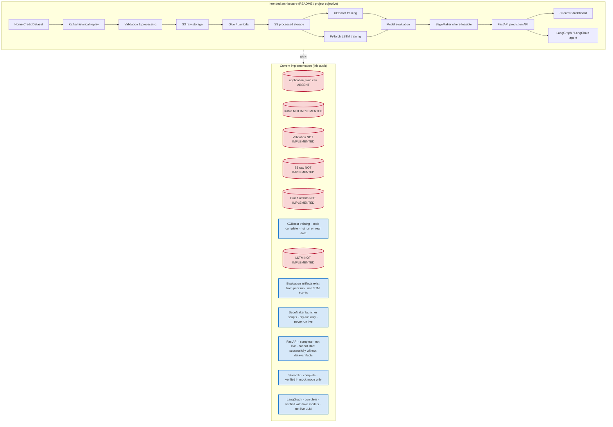
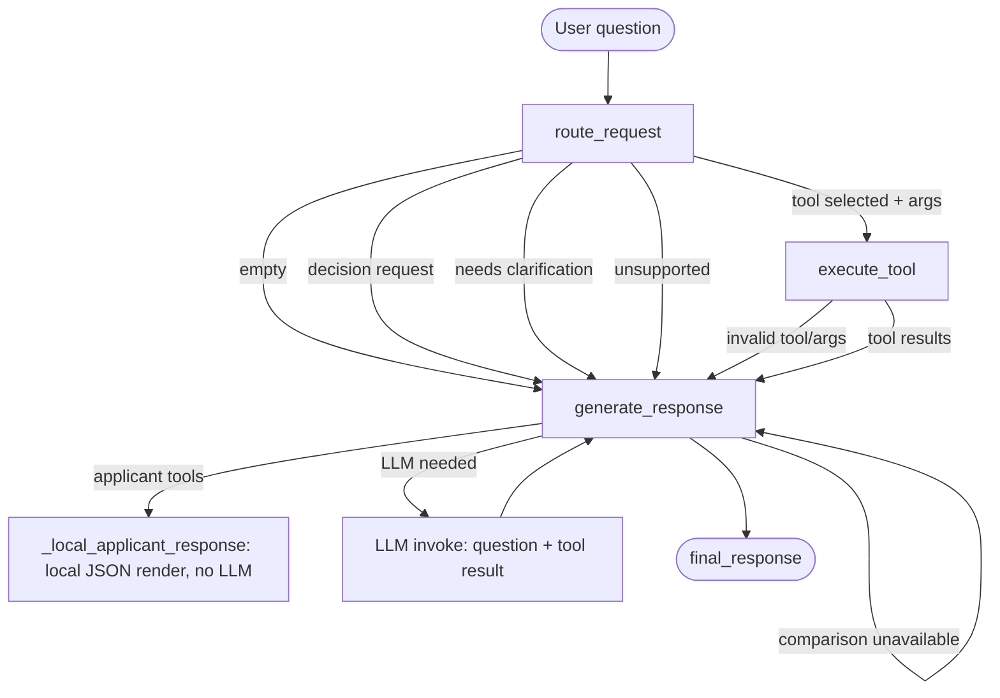

# Credit Risk Intelligence Platform — Full Technical Audit

**Repository:** `C:\Users\souro\Desktop\CreditRisk` (GitHub: `NOURSHILI-debug/CreditRisk`)
**Branch audited:** `main`
**Commit audited (HEAD):** `4389013ae178e3b0280811b1f025b10b7ff9f118`
**Working tree:** clean, up to date with `origin/main`
**Audit date:** 2026-11-18
**Auditor:** Senior Software Architect & Full-Stack ML/Data Engineering Auditor

---

## Table of contents

1. [Executive summary](#executive-summary)
2. [PART I — Repository and Git forensic audit](#part-i---repository-and-git-forensic-audit)
3. [PART II — Architecture and system design](#part-ii---architecture-and-system-design)
4. [PART III — Data engineering audit](#part-iii---data-engineering-audit)
5. [PART IV — Machine learning audit](#part-iv---machine-learning-audit)
6. [PART V — Backend and API audit](#part-v---backend-and-api-audit)
7. [PART VI — Dashboard audit](#part-vi---dashboard-audit)
8. [PART VII — AI agent and LLM security audit](#part-vii---ai-agent-and-llm-security-audit)
9. [PART VIII — Testing and quality audit](#part-viii---testing-and-quality-audit)
10. [PART IX — Configuration and parameters master inventory](#part-ix---configuration-and-parameters-master-inventory)
11. [PART X — Current status and gap analysis](#part-x---current-status-and-gap-analysis)
12. [PART XI — Execution and reproducibility](#part-xi---execution-and-reproducibility)
13. [PART XII — Final engineering assessment](#part-xii---final-engineering-assessment)
14. [Final questions the report must answer](#final-questions-the-report-must-answer)
15. [Appendix: Evidence index](#appendix-evidence-index)

---

## Executive summary

### What has actually been built

A coherent, well-structured, but **incomplete** credit-risk platform. The implemented and tested core consists of:

- **XGBoost tabular classifier** — training script (`src/training/train_xgboost.py`) with a fixed stratified 70/15/15 split, `scale_pos_weight` class-imbalance handling, evaluation (ROC-AUC, PR-AUC, precision, recall, F1, confusion matrix at threshold 0.5), model/preprocessor/feature-column serialization, and stored evaluation artifacts from a prior SageMaker run (`sagemaker_run/model/evaluation_results.json`: test ROC-AUC 0.7564, PR-AUC 0.2362).
- **XGBoost inference service** — `src/inference/predictor.py` (`CreditRiskPredictor`) loading `xgboost_baseline.json` + `preprocessor.pkl`, with native XGBoost **TreeSHAP** explanations (`src/explainability/shap_explainer.py`, `pred_contribs=True`, log-odds output space, additivity and probability-reconstruction verification).
- **FastAPI prediction API** — `src/api/main.py` with `/health`, `/models`, `/model/evaluation`, `/model/prediction-summary`, `/model/global-importance`, `/applications`, `/applications/{id}`, `/predict`, `/applications/{id}/prediction`. Canonical prediction statuses (`available`, `no_prediction`, `unavailable`, `model_unavailable`, `invalid`), field allowlist (`TARGET` excluded from browsing), CORS, request logging, uniform error shape.
- **Streamlit dashboard** — `src/dashboard/app.py` with 4 pages (Overview, Application Explorer, Model Performance, AI Assistant), a dual provider mode (real FastAPI API or deterministic synthetic mock provider `src/dashboard/providers/mock_provider.py`), shared data-access layer (`src/dashboard/data_access.py`), pagination, status-preserving prediction display.
- **LangGraph AI agent** — `src/agent/graph.py` with a 6-tool allowlist (`get_dashboard_metrics`, `get_application_details`, `get_prediction`, `explain_prediction`, `get_model_comparison`, `generate_report`), Python-extracted and validated application IDs, LLM-input ID redaction, local rendering of applicant results (never sent to the response LLM), retrieved-data marked as untrusted evidence, decision-request refusal, mock-source labeling. LLM providers: OpenAI (default, `gpt-4o-mini`, temperature 0) and Ollama (`llama3.1:8b`, `http://localhost:11434`, temperature 0).
- **Report generation** — `src/agent/report_generator.py`, deterministic, source-grounded, with explicit period-coverage limitations (period filtering not supported by the sources).
- **Test suite** — 246 passed, 55 skipped, 0 failed (executed during this audit). Skips are exclusively caused by absent `data/raw/application_train.csv`, absent `models/local_v2` artifacts, or the opt-in Ollama live integration (`RUN_OLLAMA_INTEGRATION=1`).

### What is NOT implemented

- **Kafka:** zero code. `src/ingestion/kafka_producer.py`, `kafka_consumer.py`, `event_validator.py` are all empty (0 lines). No topics, brokers, consumer groups, serialization, replay, dead-letter queue, or offset management exist. Kafka is documentation-only (`docs/event_schema.md`).
- **PyTorch LSTM:** zero code. `src/training/train_lstm.py`, `sequence_builder.py`, `train_utils.py`, `training/preprocessing.py` are all empty. No sequence generation, no model architecture, no training, no inference, no backend integration.
- **S3 / Glue / Lambda:** zero runtime code. `src/storage/s3_storage.py`, `local_storage.py` are empty; `aws/glue/`, `aws/lambda/` contain empty READMEs. AWS presence is a Terraform S3 foundation (`aws/main.tf`) that references an *existing* bucket and creates folders/object placeholders — no Glue jobs, no Lambda functions, no IAM roles for ML, no MSK/Kafka.
- **Evaluation/comparison module:** `src/evaluation/*.py` files are all empty. Comparison logic exists only inside `src/dashboard/data_access.py` and `src/agent/tools.py`.
- **Contracts:** `src/contracts/*.py` and `schemas/*.json` are all empty.
- **Monitoring:** `src/monitoring/*.py` files are empty.
- **Config YAMLs:** `configs/kafka.yaml`, `configs/xgboost.yaml`, `configs/preprocessing.yaml`, `configs/lstm.yaml`, `configs/aws.yaml` are all empty (0 lines).

### Data and model artifacts

- `data/raw/application_train.csv` — **absent** (gitignored, not tracked). The Home Credit dataset is not in the repository.
- `models/local_v2/` — **absent** (gitignored). No model binary, preprocessor, feature columns, or evaluation artifact is present locally.
- `sagemaker_run/model/` — tracked metadata JSONs only (`model_metadata.json`, `evaluation_results.json`, `feature_columns.json`, `preprocessor_metadata.json`, `training_metadata.json`, `extra_metrics.json`). Evidence of a prior SageMaker training run (Linux, Python 3.12.15, XGBoost 3.2.0) but **no model binary and no predictions CSVs** are in the repo.

### Most important technical findings

1. **The intended architecture is only partially realized.** The data → ML → FastAPI → Streamlit → Agent stack exists in code, but the left side (Kafka → processing → S3) and the LSTM branch are absent.
2. **No live end-to-end flow has been verified.** The API was not running during the prior Group D validation (no listener on port 8000); the dataset and `models/local_v2` are absent. The dashboard and agent are verified **only in mock mode** (synthetic data) plus contract-level tests with `httpx.MockTransport` and FastAPI `TestClient` against synthetic fixtures.
3. **A fair XGBoost-vs-LSTM comparison is impossible today** — LSTM is not implemented, so no LSTM evaluation scores exist. The dashboard and agent explicitly report "LSTM: Not available" and withhold direct comparison unless compatible protocol metadata for both models is supplied.
4. **Configuration files that should hold parameters are empty** (`configs/*.yaml` are 0 lines). All real parameters are hard-coded in Python source (train script, predictor, agent graph, mock provider).
5. **Security is code-enforced at the application boundary** (allowlists, redaction, local rendering, untrusted-evidence prompts), but there is **no authentication or authorization** on the FastAPI service, and no TLS/secret management. The README itself states: "authentication is required before any real deployment."
6. **Environment mismatch:** README and CI target Python 3.11; the local `.venv` runs Python 3.13.3. `pandas 3.1.0` is installed (requirements only say `>=2.0.0`); `scikit-learn 1.6.1` and `xgboost 3.2.0` are pinned and match.
7. **The `shap` package is not a dependency.** Explainability uses XGBoost's native TreeSHAP (`booster.predict(pred_contribs=True)`), which is implemented and tested, but it is not the `shap` library and there is no LSTM explanation path.

---

## PART I — Repository and Git forensic audit

### 4. Repository structure

Directory tree (tracked files only; data and model artifact directories are gitignored and absent):

```
CreditRisk/
├── .github/
│   ├── PULL_REQUEST_TEMPLATE.md
│   └── workflows/
│       └── ci.yml                     # CI: pytest + ruff on Python 3.11, push/PR to main
├── aws/
│   ├── glue/README.md                 # empty (0 lines) — Glue: planned, no code
│   ├── lambda/README.md               # empty (0 lines) — Lambda: planned, no code
│   ├── sagemaker/
│   │   ├── README.md                  # empty (0 lines)
│   │   ├── requirements.txt           # numpy, pandas, scikit-learn==1.6.1, xgboost==3.2.0, joblib, scipy
│   │   ├── run_sagemaker.py           # SageMaker training-job launcher (dry-run by default; --run contacts AWS)
│   │   ├── train.py                   # SageMaker entry point wrapping src/training/train_xgboost.train()
│   │   ├── processing_entrypoint.py   # SageMaker Processing wrapper around the shared trainer
│   │   ├── run_processing.py          # SageMaker Processing launcher (dry-run by default)
│   │   └── compare_metrics.py         # Local-vs-SageMaker test-metrics/predictions comparator
│   ├── main.tf                        # Terraform: S3 foundation only (references EXISTING bucket; folders raw/processed/rejected/models/reports)
│   ├── variables.tf                   # region=us-east-1, project=credit-risk
│   ├── outputs.tf                     # bucket_name output
│   └── README.md                      # empty (0 lines)
├── configs/                           # ALL YAML configs are empty (0 lines): kafka, xgboost, preprocessing, lstm, aws
├── data/                              # raw/, interim/, processed/ are gitignored and ABSENT
│   └── README.md                      # empty (0 lines)
├── docs/                              # documentation (see inventory below); architecture.md is EMPTY (0 lines)
├── sagemaker_run/                     # metadata JSONs from a prior SageMaker run (tracked); no model binary, no CSVs
│   ├── model/
│   │   ├── evaluation_results.json    # XGBoost test metrics (ROC-AUC 0.756421, PR-AUC 0.236175, ...), threshold 0.5
│   │   ├── extra_metrics.json         # KS per split
│   │   ├── feature_columns.json
│   │   ├── model_metadata.json        # model_name=XGBoost, version=baseline-v2-local, hash, 120 input / 306 transformed features
│   │   ├── preprocessor_metadata.json
│   │   └── training_metadata.json
│   └── reports/
│       ├── evaluation_results.json    # duplicate of model/evaluation_results.json
│       └── extra_metrics.json
├── schemas/                           # application_event, model_metadata, prediction_result schemas — ALL EMPTY (0 lines)
├── src/                               # Python source (packages below)
│   ├── agent/                         # LangGraph agent (Person 2): graph.py, privacy.py, prompts.py, tools.py, state.py, report_generator.py
│   ├── api/                           # FastAPI backend (Person 2/shared): main.py, config.py, state.py, service.py, repository.py, features.py, schemas.py, status.py, fields.py, errors.py, logging_config.py, serialization.py, dependencies.py, routers/{applications,health,models,predictions}
│   ├── contracts/                     # events.py, interfaces.py, predictions.py — ALL EMPTY (0 lines)
│   ├── dashboard/                     # Streamlit dashboard (Person 2): app.py, api_client.py, data_access.py, providers/{mock_provider}, pages/{overview,application_explorer,model_comparison,assistant}, components/{charts,metrics,prediction_view,theme,ui}
│   ├── evaluation/                    # comparison, evaluate_models, metrics, plots — ALL EMPTY (0 lines)
│   ├── explainability/                # shap_explainer.py, generate_shap_report.py, plots.py
│   ├── inference/                     # predictor.py (implemented); model_loader.py and prediction_service.py EMPTY
│   ├── ingestion/                     # kafka_producer.py, kafka_consumer.py, event_validator.py — ALL EMPTY (0 lines)
│   ├── monitoring/                    # pipeline_logger.py, pipeline_status.py — ALL EMPTY (0 lines)
│   ├── processing/                    # preprocessing.py (implemented); cleaning.py, data_validation.py, feature_engineering.py, transformations.py EMPTY
│   ├── storage/                       # s3_storage.py, local_storage.py — ALL EMPTY (0 lines)
│   ├── training/                      # train_xgboost.py (implemented); train_lstm.py, sequence_builder.py, train_utils.py, preprocessing.py EMPTY
│   └── project_paths.py               # models/local_v2 resolution, CREDIT_RISK_MODEL_DIR override
├── tests/                             # unit/ and integration/
├── .gitignore                         # ignores data/*, models/, artifacts/, *.pkl/joblib/pt, .venv, *.log, .env, terraform state
├── .pre-commit-config.yaml            # EMPTY (0 lines)
├── .python-version                    # EMPTY (0 lines)
├── .pytest_cache/                     # local cache (untracked)
├── .venv/                             # local virtualenv (untracked), Python 3.13.3
├── Makefile                           # install, lint, test, ci targets
├── pyproject.toml                     # pytest config, ruff config (E9, F63, F7, F82; py311; line-length 88)
├── requirements.txt                   # streamlit, pandas, numpy, plotly, langgraph, langchain-openai, langchain-ollama, scikit-learn==1.6.1, xgboost==3.2.0, joblib, matplotlib, fastapi==0.162.0, uvicorn==0.54.0, httpx==0.28.1
├── requirements-dev.txt               # pytest>=8.0, ruff>=0.6.0
├── README.md                          # project readme (architecture diagram, stack, setup, deliverables, status)
├── LICENSE
└── compare_metrics.py                 # root-level copy of aws/sagemaker/compare_metrics.py (duplicated; default --local models/local_v2 --sagemaker sagemaker_run)
```

**Ownership notes:** Person 1 (Data Engineering and ML) owns ingestion, processing, storage, training, inference, evaluation, S3/Glue/Lambda/SageMaker code. Person 2 (Dashboard, AI Agent, Application Engineering) owns dashboard, API client integration, agent, reports. Architecture, schemas, contracts, integration, testing, security, documentation are shared. Empty files in a module usually indicate that module's implementation is missing or was never completed.

**Duplicated code:** `compare_metrics.py` exists at both repository root and `aws/sagemaker/compare_metrics.py` (functionally identical CLI comparator). `sagemaker_run/model/evaluation_results.json` and `sagemaker_run/reports/evaluation_results.json` are identical duplicates. `src/api/status.py` canonical statuses vs legacy `predict_credit_risk()` `success`/`error` values are two parallel vocabularies (documented as intentional legacy).

**Experimental / unused:** `sagemaker_run/` metadata appears to be leftover evidence from a completed SageMaker training job rather than an active runtime artifact (the API resolves `models/local_v2`, not `sagemaker_run/model`). Empty `contracts/`, `evaluation/`, `storage/`, `monitoring/`, `ingestion/` modules are placeholders with no imports elsewhere.

### 5. Git history and project state

- **Current branch:** `main` (also tracked locally: `feature/dashboard`, `feature/llm-agent-tools-and-reporting`, `feature/ollama-llm-provider`, `feature/optional-mock-data-provider`, `feature/person2-agent-validation`, `feature/person2-api-integration`, `feature/person2-e2e-validation`, `feature/person2-group-a-fixes`, `feature/task-18-report-generation`).
- **Remote-tracking branches (origin):** `Developement` (sic), `FastAPI`, `HEAD -> origin/main`, `MlXGboost`, `chore/ci-and-local-first`, `docs/data-dictionary`, `docs/evaluation-protocol`, `docs/event-schema`, `docs/prediction-schema`, `feat/sagemaker-baseline`, `feature/api-contract`, `feature/dashboard`, `feature/llm-agent-tools-and-reporting`, `feature/ollama-llm-provider`, `feature/person2-e2e-validation`, `feature/task-18-report-generation`, `infra/aws-foundation`, `main`.
- **HEAD commit:** `4389013ae178e3b0280811b1f025b10b7ff9f118` — "Merge pull request #19 from NOURSHILI-debug/feat/sagemaker-baseline".
- **Working tree:** clean; no uncommitted changes.
- **Branch divergence:** `main` is up to date with `origin/main`. The local feature branches point at various commits (e.g. `feature/person2-group-a-fixes` and `feature/optional-mock-data-provider` point at `0279866`, same as `main` per the handoff).

**Recent major milestones (from `git log`):**

| Commit | Summary |
|---|---|
| `4389013` (HEAD) | Merge PR #19 `feat/sagemaker-baseline` |
| `805fec6` | docs: add sagemaker baseline metrics and metadata |
| `85e8487` | add handoff (`docs/person2_handoff.md`) |
| `4a7aee3` | Merge PR #18 `feature/person2-e2e-validation` |
| `4b4e992` | test(person2): complete dashboard and agent validation |
| `8df1e16` | feat(agent): harden prompt injection protection (Group C) |
| `7896917` | feat: integrate dashboard and agent with API contracts (Groups A+B) |
| `98ce6eb` | feat: add local vs sagemaker metrics comparison |
| `5316fef` | feat: add sagemaker processing launcher for baseline |
| `a588dd2` | feat: add SageMaker baseline runner |
| `f2b52bb` | ci: add local-first test and lint pipeline |
| `66c15d3` | infra: add terraform s3 foundation for learner lab |
| `7bcebf9` | Add comprehensive data dictionary |

**Does current implementation match the Person 2 handoff?** Partially. The handoff (`docs/person2_handoff.md`) was prepared on branch `feature/person2-e2e-validation` at commit `4b4e992` (3 commits ahead of then-`origin/main`). Current `main` is `4389013`, which is *ahead* of the handoff base and includes the Sagamaker-baseline merge (`805fec6`) plus the handoff document itself (`85e8487`). The code the handoff describes (mock provider, dashboard/agent integration, prompt hardening, AppTest validation) is present in `main`. The handoff's documented blockers (absent `data/raw/application_train.csv`, absent `models/local_v2`, no listener on port 8000) **remain true in the current tree**.

**Unfinished work / uncommitted work:** none uncommitted (tree clean). Unfinished: dataset download, Kafka pipeline, S3/Glue/Lambda runtime, LSTM training/inference, model-comparison execution, live API/dashboard integration, live LLM integration, authentication.

**Abandoned branches:** Local feature branches `feature/person2-group-a-fixes` and `feature/optional-mock-data-provider` point at the same commit as `main` (`0279866` base per handoff) — they add no separate commits. Remote branches such as `Developement`, `FastAPI`, `MlXGboost` exist on origin but were not inspected in detail (read-only audit; no fetch performed beyond existing refs).

**Integration conflicts:** None apparent in the current tree (it builds and tests pass). The principal integration gap is architectural rather than a merge conflict: Person 1's deliverables (dataset, Kafka, artifacts) are absent, so Person 2's API-backed dashboard/agent paths cannot be exercised end-to-end.

---

## PART II — Architecture and system design

### 6. Actual architecture

The actual (code-realized) architecture differs materially from the intended architecture. The left side of the pipeline (Kafka, validation, S3, Glue/Lambda) has **no implementation**. The right side (ML training, inference, API, dashboard, agent) is implemented but **cannot run end-to-end** because the dataset (`data/raw/application_train.csv`) and model artifacts (`models/local_v2/`) are absent.

Mermaid diagram of components that ACTUALLY exist (solid = implemented code path; dashed = planned/unverified connection):

```mermaid
flowchart TD
    subgraph DATA["Data (absent from repo)"]
        A[application_train.csv · NOT PRESENT · gitignored]
        B[installments_payments.csv · NOT PRESENT]
    end

    subgraph INGESTION["Ingestion · NOT IMPLEMENTED (empty files)"]
        C[kafka_producer.py · empty]
        D[kafka_consumer.py · empty]
        E[event_validator.py · empty]
    end

    subgraph STORAGE["Storage · no runtime implementation"]
        F[S3 raw/processed · Terraform only; references existing bucket]
        G[Glue/Lambda · no code, empty READMEs]
    end

    subgraph ML["ML training & inference · IMPLEMENTED"]
        H[src/training/train_xgboost.py · 70/15/15 split, XGBClassifier]
        I[src/inference/predictor.py · CreditRiskPredictor, XGBClassifier.load_model]
        J[src/explainability/shap_explainer.py · native TreeSHAP, pred_contribs=True]
        K[models/local_v2/ · ABSENT · gitignored]
    end

    subgraph AWS["AWS · planned/dry-run only"]
        L[aws/sagemaker/run_sagemaker.py · dry-run default, --run contacts AWS]
        M[aws/sagemaker/run_processing.py · dry-run default]
        N[sagemaker_run/model/ · metadata JSONs only; no model binary]
    end

    subgraph API["FastAPI backend · IMPLEMENTED (not live)"]
        O[src/api/main.py · /health /models /model/evaluation /predict /applications]
    end

    subgraph DASH["Streamlit dashboard · IMPLEMENTED"]
        P[src/dashboard/app.py · 4 pages, API or mock provider]
        Q[src/dashboard/providers/mock_provider.py · deterministic synthetic data]
    end

    subgraph AGENT["LangGraph agent · IMPLEMENTED"]
        R[src/agent/graph.py · 6-tool allowlist, privacy, routing]
        S[LLM · OpenAI default / Ollama · NOT live-tested]
    end

    A -.->|historical replay · NOT IMPLEMENTED| C
    C -.->|validate · NOT IMPLEMENTED| E
    E -.->|S3 raw · NOT IMPLEMENTED| F
    H -.->|train on A · NOT RUNNABLE (A absent)| K
    H -.->|artifacts →| K
    I -.->|loads artifacts from| K
    J -.->|explains via| I
    K -.->|loads at startup· FAILS if absent| O
    O -.->|serves| P
    O -.->|tools call via data_access| R
    P -.->|reads| Q
    Q -.->|fallback (explicit only)| P
    R -.->|calls| Q
    R -.->|calls| O
    S -.->|drives routing| R
```

**Components that exist only as empty files / documentation:** `src/ingestion/*`, `src/processing/{cleaning,data_validation,feature_engineering,transformations}`, `src/training/{train_lstm,sequence_builder,train_utils,preprocessing}`, `src/evaluation/*`, `src/storage/*`, `src/monitoring/*`, `src/inference/{model_loader,prediction_service}`, `src/contracts/*`, `schemas/*.json`, `configs/*.yaml`, `docs/architecture.md`, `aws/glue/*`, `aws/lambda/*`.

### Intended vs. current implementation



**Differences intended vs. actual:**

| Intended stage | Actual state | Evidence |
|---|---|---|
| Kafka producer/consumer, topics, replay | Not implemented — empty files | `src/ingestion/kafka_producer.py`, `kafka_consumer.py`, `event_validator.py` (0 lines each) |
| Data validation/transformation | Partial — preprocessing only; cleaning/validation/feature_engineering empty | `src/processing/preprocessing.py` implemented; `cleaning.py`, `data_validation.py`, `feature_engineering.py`, `transformations.py` empty |
| S3 raw/processed storage | Not implemented — Terraform references existing bucket only | `aws/main.tf`, `src/storage/s3_storage.py` (0 lines) |
| Glue / Lambda | Not implemented | `aws/glue/README.md`, `aws/lambda/README.md` (0 lines) |
| XGBoost training/inference | Implemented (code complete) | `src/training/train_xgboost.py`, `src/inference/predictor.py` |
| XGBoost evaluation | Implemented; metrics stored from prior run | `train_xgboost.py` `compute_metrics`; `sagemaker_run/model/evaluation_results.json` |
| PyTorch LSTM | Not implemented | `src/training/train_lstm.py` etc. (0 lines) |
| SageMaker | Launcher scripts exist; dry-run default; metadata from past run only | `aws/sagemaker/run_sagemaker.py`, `run_processing.py` |
| FastAPI | Implemented; not live | `src/api/main.py` and routers |
| Streamlit dashboard | Implemented; verified mock-mode only | `src/dashboard/app.py`, 4 pages |
| LangGraph agent + 6 tools | Implemented; fake-model tests only | `src/agent/graph.py`, `tools.py` |
| SHAP explanations | Implemented via native TreeSHAP | `src/explainability/shap_explainer.py` |
| Reports | Implemented | `src/agent/report_generator.py` |
| Automated tests | Implemented; 246 passed / 55 skipped | `tests/` |
| Live end-to-end | Not verified — blocked by missing dataset, artifacts, backend | Handoff + this audit |

### 7. Component communication and data flow

**Actual executable flow (where code exists):**

1. **Data origin:** No data originates in the repo. `data/raw/application_train.csv` is expected at project root but is absent (gitignored). `src/training/train_xgboost.py` `DATA_PATH = PROJECT_ROOT / "data" / "raw" / "application_train.csv"`; API default `CREDIT_RISK_APPLICATION_DATA = "data/raw/application_train.csv"` (`src/api/config.py`).
2. **Loading:** `src/api/repository.py` `ApplicationRepository._load()` reads the CSV with pandas, validates `SK_ID_CURR`, rejects duplicates, sorts by ID, indexes. Computes numeric min/max bounds for feature validation. Excludes `TARGET` from lookups (`get_by_id` drops `TARGET`; `get_full_by_id` retains it).
3. **Validation:** `src/api/features.py` `FeatureValidator.validate()` — rejects unknown columns, rejects `TARGET` as input, requires all model feature columns, imputes missing to `np.nan`, range-checks numerics against observed training bounds, requires strings for categoricals, positive-integer ID.
4. **Storage:** No write path exists locally. Terraform `aws/main.tf` would create folders `raw/`, `processed/`, `rejected/`, `models/`, `reports/` in an existing bucket (data resource, not created). No object format, partitioning, or naming convention is implemented in code.
5. **Feature generation / preprocessing:** `src/processing/preprocessing.py` — `DaysEmployedSentinelFixer` replaces `DAYS_EMPLOYED == 365243` with NaN and replaces ±inf with NaN; `build_preprocessor` builds a sklearn `ColumnTransformer`: numeric → `SimpleImputer(strategy="median", add_indicator=True)`; categorical → `SimpleImputer(strategy="most_frequent")` + `OneHotEncoder(handle_unknown="ignore")`; `remainder="drop"`, `sparse_threshold=0.3`. Fitted on train only in `train_xgboost.py`.
6. **Model training:** `src/training/train_xgboost.py` `train()` — reads CSV, stratified split 70/15/15 (seed 42), fits preprocessor on train only, computes `scale_pos_weight = n_neg/n_pos` on train, fits `XGBClassifier` with `eval_set=[(val)]`, saves `xgboost_baseline.json`, `preprocessor.pkl`, `feature_columns.json`, `preprocessor_metadata.json`, `model_metadata.json`, `validation_predictions.csv`, `test_predictions.csv`, `evaluation_results.json`, `extra_metrics.json`, `training_metadata.json`.
7. **Model artifacts:** Expected in `models/local_v2/` (resolved via `src/project_paths.py`, overridable with `CREDIT_RISK_MODEL_DIR`). Absent from repo. Prior-run metadata in `sagemaker_run/model/` (tracked, but no binary).
8. **Inference:** FastAPI lifespan `build_state()` (`src/api/state.py`) loads metadata JSONs, `evaluation_results.json`, `global_importance.json`, `validation/test_predictions.csv`, constructs `CreditRiskPredictor(settings.model_dir)` and `ShapExplainer(settings.model_dir)`, loads `ApplicationRepository(settings.application_data_path)`, builds `FeatureValidator`. Endpoints: `POST /predict` and `GET /applications/{id}/prediction` → `PredictionService.predict_by_application_id` → repository row lookup → `predictor.predict()` (preprocessor.transform → `predict_proba` class 1) → optional `ShapExplainer.explain_application` (TreeSHAP).
9. **Backend retrieval of application records:** `GET /applications` (paginated, field-allowlisted, optional ID/category filter) and `GET /applications/{id}` via `ApplicationRepository.list_rows` / `get_full_by_id`. `TARGET` never returned by applicant-browsing endpoints.
10. **Dashboard requests:** `src/dashboard/api_client.py` `APIClient` (httpx, base URL `CREDIT_RISK_API_URL` default `http://127.0.0.1:8000`, timeout 20s) calls `/health`, `/applications`, `/applications/{id}`, `/applications/{id}/prediction`, `/models`, `/model/evaluation`, `/model/prediction-summary`. `src/dashboard/data_access.py` dispatches to API client in `api` mode or `mock_provider` in `mock` mode; no silent fallback on API errors.
11. **Agent tool calls:** `src/agent/graph.py` `route_request` (LLM structured routing via `RouteDecision`, redacted question) → `execute_tool` (Python allowlist `_ALLOWED_TOOLS`, Python-extracted application ID) → tool functions in `src/agent/tools.py` → `src/dashboard/data_access.py` functions → API client or mock provider.
12. **LLM context:** Router prompt `prompts.ROUTER_SYSTEM_PROMPT` receives `platform_facts` + redacted question. Response prompt `prompts.RESPONSE_SYSTEM_PROMPT` receives the question and JSON-serialized `tool_result` (applicant identifiers redacted first via `privacy.redact_applicant_identifier_fields`; applicant lookups minimized via `privacy.minimize_application_lookup`). Applicant results are rendered locally (`_local_applicant_response`) and never enter the response LLM context.
13. **Predictions/explanations returned:** API returns canonical status + probability + risk level + model name/version/timestamp + optional TreeSHAP explanation (method `tree_shap`, output space `log_odds`, top features with shap values/effects). Dashboard normalizes via `normalize_prediction_response`; agent returns minimized JSON.

**Interfaces that are only proposed or mocked:** Kafka producer/consumer/validator (empty files), S3 storage (empty files), Glue/Lambda (no code), evaluation module (empty files), contracts/schemas (empty files), LSTM (empty files), monitoring (empty files), model_loader/prediction_service (empty files). All are documented or planned but not implemented.

---

## PART III — Data engineering audit

### 8. Dataset analysis

**Expected dataset:** Home Credit Default Risk (`application_train.csv`, `application_test.csv`, `installments_payments.csv`, and others).

| Item | Status | Evidence |
|---|---|---|
| `application_train.csv` present locally | ABSENT | `data/raw/` does not exist; gitignored (`data/raw/*`) |
| `application_test.csv` referenced | NOT FOUND in code | No code references `application_test.csv` |
| `installments_payments.csv` present locally | ABSENT | Not in repo; referenced in `docs/event_schema.md` and mock provider only |
| Dataset download script | NOT IMPLEMENTED | No download/kaggle API script found |
| Dataset dimensions | UNKNOWN | File absent |
| Column counts | UNKNOWN | File absent |
| Identifier field | `SK_ID_CURR` | `src/api/repository.py` `ID_COLUMN`; `src/api/features.py` |
| Target field | `TARGET` (1 = repayment difficulty, 0 = none) | `src/training/train_xgboost.py`, `README.md`, `docs/api_contract.md` |
| Data types | UNKNOWN | File absent |
| Missing-value handling | Implemented in preprocessor (median + indicators; most frequent) | `src/processing/preprocessing.py` |
| Duplicate handling | `SK_ID_CURR` duplicates rejected (`DuplicateApplicationIdError`) | `src/api/repository.py` lines 45-53 |
| Feature transformations | ColumnTransformer median imputation + missing indicators; OHE | `src/processing/preprocessing.py` `build_preprocessor` |
| Target distribution | UNKNOWN (file absent); prior run: train 8.07% pos, val/test 8.07% | `sagemaker_run/model/evaluation_results.json` splits |
| Class imbalance | `scale_pos_weight = n_neg/n_pos` on train (prior run 11.387) | `train_xgboost.py` line 321; evaluation artifact |
| Join relationships | Not implemented; no multi-table join pipeline | No code joins Home Credit auxiliary tables |
| Temporal fields | `DAYS_BIRTH`, `DAYS_EMPLOYED` (relative days); installment `DAYS_INSTALMENT`, `DAYS_ENTRY_PAYMENT` exist only in mock provider schema | `src/dashboard/providers/mock_provider.py` |

**Installments and LSTM sequences:** The implementation does **not** construct chronological installment sequences. `src/training/sequence_builder.py` is empty (0 lines). `docs/evaluation.md` states the LSTM leakage rule (sequences must use only data available before the application date) but there is no code. The mock provider generates `installments_payments` with `DAYS_INSTALMENT`/`NUM_INSTALMENT_NUMBER` sorted per `(SK_ID_CURR, SK_ID_PREV)` (test `test_mock_historical_tables_have_valid_foreign_keys_and_ordered_installments`), but this is synthetic demo data, not a sequence-generation pipeline. **Conclusion: no installment sequences suitable for LSTM training are generated.**

### 9. Data preprocessing

Preprocessing exists in two places: `src/processing/preprocessing.py` (training pipeline) and `src/api/features.py` + `src/api/repository.py` (inference-time validation bounds). The YAML config `configs/preprocessing.yaml` is empty.

| Processing step | Implementation | Exact parameters | Input | Output | Evidence | Status |
|---|---|---|---|---|---|---|
| DAYS_EMPLOYED sentinel fix | `DaysEmployedSentinelFixer` | sentinel=365243, column=DAYS_EMPLOYED → NaN; ±inf → NaN | raw frame | cleaned frame | `src/processing/preprocessing.py` lines 19-48 | IMPLEMENTED (unit-tested) |
| Column split | `split_feature_columns` | excludes SK_ID_CURR, TARGET; object/string/categorical dtype → categorical; rest numeric | frame | (feature_columns, numeric, categorical) | `src/processing/preprocessing.py` lines 63-85 | IMPLEMENTED |
| Numeric imputation | `SimpleImputer(strategy="median", add_indicator=True)` | median, missing-indicator column `num__missingindicator_*` | numeric columns | imputed numeric matrix | `src/processing/preprocessing.py` line 98 | IMPLEMENTED |
| Categorical imputation | `SimpleImputer(strategy="most_frequent")` | most frequent | categorical columns | imputed categorical | line 104 | IMPLEMENTED |
| Categorical encoding | `OneHotEncoder(handle_unknown="ignore")` | unknown categories → all zeros | categorical columns | one-hot matrix | line 105 | IMPLEMENTED |
| Column selection | `ColumnTransformer(..., remainder="drop")` | drop non-listed | all | transformed matrix | lines 108-114 | IMPLEMENTED |
| Sparse threshold | `sparse_threshold=0.3` | 0.3 | — | sparse/dense output | line 114 | IMPLEMENTED |
| Train/val/test split | `train_test_split` twice | stratify=TARGET, test_size=0.30 then 0.5, random_state=42 → 70/15/15 | X, y | train/val/test | `src/training/train_xgboost.py` lines 286-299 | IMPLEMENTED (not run on real data) |
| Class imbalance | `scale_pos_weight = n_neg/n_pos` | computed on train only | y_train | float weight | `train_xgboost.py` line 321 | IMPLEMENTED |
| Numeric bounds (inference) | `ApplicationRepository._compute_numeric_bounds` | min/max per numeric column (excl. ID, TARGET) | frame | bounds dict | `src/api/repository.py` lines 60-71 | IMPLEMENTED |
| Incoming feature validation | `FeatureValidator.validate` | range check vs bounds; null→NaN; string check for categoricals | feature mapping | DataFrame row | `src/api/features.py` lines 41-78 | IMPLEMENTED |
| Random seed | SEED = 42 | 42 | — | — | `train_xgboost.py` line 51 | IMPLEMENTED |
| Serialization | joblib preprocessor, XGBoost JSON model, JSON metadata | — | fitted objects | `models/local_v2/*` | `train_xgboost.py` lines 347-362, 387-409 | IMPLEMENTED (artifacts absent) |
| Leakage prevention | Preprocessor fit on train only; TARGET excluded from features; eval_set val only; test scored once | documented | — | — | `train_xgboost.py` lines 308-343; `docs/evaluation.md` | IMPLEMENTED in code, unverified on real data |

Missing-value strategy is defined (median + indicator; most frequent), but no global missing-value report or column-drop policy exists in code.

### 10. Kafka and streaming

**Classification: NOT IMPLEMENTED — documentation only.**

| Item | Expected | Actual | Evidence |
|---|---|---|---|
| Producer implementation | Kafka producer sending application events | NOT IMPLEMENTED | `src/ingestion/kafka_producer.py` is 0 lines |
| Consumer implementation | Kafka consumer writing to storage | NOT IMPLEMENTED | `src/ingestion/kafka_consumer.py` is 0 lines |
| Kafka library | — | Not installed (`confluent_kafka`/`kafka-python` absent from requirements) | `requirements.txt` |
| Bootstrap servers | — | NOT CONFIGURED | `configs/kafka.yaml` is 0 lines |
| Topic names | e.g. application events | NOT DEFINED | No code; `docs/event_schema.md` describes event schema only |
| Message format | JSON event (event_id, event_timestamp, SK_ID_CURR, schema_version, features) | Schema documented only | `docs/event_schema.md` |
| Serialization | — | NOT IMPLEMENTED | No code |
| Event schema | schema-v1 | Documented only | `docs/event_schema.md` |
| Historical replay | Replay `application_train.csv` rows as events | NOT IMPLEMENTED | No code |
| Replay speed/timing | — | NOT DEFINED | No code |
| Consumer groups | — | NOT DEFINED | No code |
| Offset management | — | NOT IMPLEMENTED | No code |
| Retry logic | — | NOT IMPLEMENTED | No code |
| Dead-letter handling | Invalid events → DLQ + S3 `rejected/` | Documented only | `docs/event_schema.md` lines 63-67 |
| Validation | Event validation rules | Documented only | `docs/event_schema.md` lines 49-61 |
| Idempotency | — | NOT IMPLEMENTED | No code |
| Logging | — | NOT IMPLEMENTED | No code |

**Trace one event from producer to final storage:** Cannot be traced — no producer, consumer, broker, topic, or storage write exists. `src/ingestion/event_validator.py` is empty, so even the documented validation rules are not enforced anywhere in code. The platform's streaming layer is entirely aspirational/documentation.

---

## PART IV — Machine learning audit

### 12. XGBoost implementation

#### Dataset and features
- **Input dataset:** `data/raw/application_train.csv` (absent from repo). `DATA_PATH = PROJECT_ROOT / "data" / "raw" / "application_train.csv"` (`src/training/train_xgboost.py` line 47).
- **Target:** `TARGET` (1 = repayment difficulty). Positive class = 1. `probability_semantics = P(TARGET=1)`.
- **Feature columns:** All columns except `SK_ID_CURR` and `TARGET` (120 raw features per prior-run `model_metadata.json` `feature_columns_count: 120`). Split into numeric/categorical by dtype in `split_feature_columns`.
- **Excluded columns:** `SK_ID_CURR`, `TARGET`. `DAYS_EMPLOYED` sentinel 365243 → NaN before imputation.
- **Preprocessing:** `build_preprocessor` (median imputation + missing indicators for numeric; most frequent + OHE for categorical). 306 post-transform features (120 raw + one-hot expansion + missing indicators).
- **Leakage prevention:** Preprocessor fitted on TRAIN only; stratified split; `scale_pos_weight` on train only; test scored once post-training; `eval_set` is validation only. `TARGET` excluded from feature columns and from API browsing.

#### Training configuration (exact values from `src/training/train_xgboost.py`)

| Parameter | Value | Source |
|---|---|---|
| Algorithm/library | XGBoost `XGBClassifier` (scikit-learn wrapper) | line 29, 331 |
| Booster | `gbtree` (XGBClassifier default; not explicitly set) | not explicit (default) |
| Objective | `binary:logistic` | `XGBOOST_PARAMS` line 55 |
| Evaluation metrics | `["auc", "aucpr"]` | `XGBOOST_PARAMS` line 62 |
| n_estimators | 1000 | line 56 |
| max_depth | 6 | line 57 |
| learning_rate | 0.05 | line 58 |
| subsample | 0.8 | line 59 |
| colsample_bytree | 0.8 | line 60 |
| random_state | 42 | line 61 |
| tree_method | `hist` | line 63 |
| n_jobs | -1 | line 64 |
| device | `cpu` | line 65 |
| scale_pos_weight | `n_neg/n_pos` on TRAIN only (prior run 11.38746619094205) | line 321 |
| Early stopping | None (no `early_stopping_rounds`; `eval_set` used for logging only) | NOT CONFIGURED |
| Train/val/test ratios | 0.70 / 0.15 / 0.15 | `SPLIT_RATIOS` line 53 |
| Random seed | 42 | `SEED` line 51 |
| Decision threshold | 0.5 | `THRESHOLD` line 52 |
| Hyperparameter search | None | NOT IMPLEMENTED |
| Hardware | CPU, `n_jobs=-1` | `XGBOOST_PARAMS` |

Note: `BASELINE_REFERENCE` (prior Colab baseline ROC-AUC 0.7571 etc.) is context only, "not a tuning target" (line 67-76). `compare_to_baseline` compares test metrics to that reference with tolerance 0.01.

#### Training execution
- **Entry point:** `python src/training/train_xgboost.py` (`--data-path`, `--output-dir`; defaults to `data/raw/application_train.csv` and `models/local_v2`).
- **Call sequence:** `main()` → `train()` → load CSV → `split_feature_columns` → stratified `train_test_split` → `build_preprocessor` → `preprocessor.fit(X_train)` → `XGBClassifier(**params)` → `model.fit(X_train_t, y_train, eval_set=[(X_val_t, y_val)])` → save model/preprocessor/features/metadata → `predict_proba` on val/test → `compute_metrics` at threshold 0.5 → `compute_ks` → write `evaluation_results.json`, `extra_metrics.csv`-style JSON, predictions CSVs, `training_metadata.json`.
- **Serialization:** `model.get_booster().save_model(...)` (XGBoost native JSON), `joblib.dump(preprocessor, ...)`, JSON for feature columns and metadata. SHA-256 recorded for each artifact.
- **Artifact directory:** `models/local_v2/` (default), overridable via `CREDIT_RISK_MODEL_DIR`.
- **Model loading:** `src/inference/predictor.py` `CreditRiskPredictor.__init__` loads `xgboost_baseline.json` + `preprocessor.pkl`, verifies SHA-256 matches `model_metadata.json`, verifies feature-count match between model and preprocessor.
- **Prediction generation:** `predictor.predict()` — drop ID/TARGET, select feature columns, `preprocessor.transform`, `predict_proba` class 1, `_risk_level` bands (LOW < 0.30, MEDIUM 0.30–0.60, HIGH >= 0.60).

#### Evaluation (from prior run stored in `sagemaker_run/model/evaluation_results.json`; NOT re-derived during this audit)

| Metric | Validation | Test |
|---|---|---|
| ROC-AUC | 0.7498 | 0.7564 |
| PR-AUC | 0.2411 | 0.2362 |
| Precision (thr 0.5) | 0.1878 | 0.1947 |
| Recall | 0.5685 | 0.5838 |
| F1 | 0.2824 | 0.2920 |
| KS | (in extra_metrics) | (in extra_metrics) |
| Confusion matrix (test) | — | TN 33409, FP 8994, FN 1550, TP 2174 |
| Threshold | 0.5 | 0.5 |
| n_samples (test) | — | 46,127 |
| Class counts (test) | — | 0: 42,403; 1: 3,724 |
| Positive rate | — | 0.0807 |

**Provenance of metrics:** Stored artifact from a previous training run (logged `generated_at 2026-11-13T21:54:52`, trained on Linux/SageMaker Python 3.12.15). Not re-executed during this audit (dataset absent). Baseline comparison (tolerance 0.01) passed with no findings.

The API router `src/api/routers/models.py` `EVALUATION_METRICS` reads only `roc_auc`, `pr_auc`, `precision`, `recall`, `f1` from `evaluation_results.json` `metrics[split]`, labels them "XGBoost", and hardcodes `"lstm_available": False` in provenance (line 115).

### 13. LSTM implementation

**Classification: NOT IMPLEMENTED.** Every file in the LSTM pipeline is empty (0 lines):

| File | Size | Content |
|---|---|---|
| `src/training/train_lstm.py` | 0 lines | empty |
| `src/training/sequence_builder.py` | 0 lines | empty |
| `src/training/train_utils.py` | 0 lines | empty |
| `src/training/preprocessing.py` | 0 lines | empty |
| `tests/unit/test_lstm.py` | 0 lines | empty |

Stage-by-stage status:

1. **Dataset preparation (installment loading):** NOT IMPLEMENTED. No code loads `installments_payments.csv` for LSTM.
2. **Sequence generation:** NOT IMPLEMENTED. `sequence_builder.py` empty. No chronological ordering, temporal cutoffs, padding, truncation, or masking.
3. **Model architecture:** NOT IMPLEMENTED. No PyTorch `nn.Module`, no layer/hidden-dimension/dropout/bidirectionality/activation/output-layer definitions. (`torch` is not even a declared dependency in `requirements.txt`.)
4. **Training:** NOT IMPLEMENTED. No loss function, optimizer, learning rate, batch size, epochs, early stopping.
5. **Evaluation:** NOT IMPLEMENTED.
6. **Serialization:** NOT IMPLEMENTED (no `.pt`/`.pth` path defined; gitignored patterns exist but no code).
7. **Inference:** NOT IMPLEMENTED. No LSTM code path in `src/api` or `src/inference`.
8. **Backend integration:** NOT IMPLEMENTED. The API hardcodes `"lstm_available": False` (`src/api/routers/models.py` line 115).

`docs/evaluation.md` (lines 70-82) explicitly acknowledges: "Only XGBoost is implemented. `src/training/train_lstm.py` and the installment-feature training path are empty."

### 14. Model comparison

- **Both models implemented?** No. Only XGBoost. LSTM is absent.
- **Same held-out applicants?** Cannot be determined — LSTM has no predictions.
- **Leakage prevention:** N/A for comparison (single model).
- **Consistent metrics:** XGBoost metrics computed consistently in `train_xgboost.py` `compute_metrics` and exposed via `/model/evaluation`. No LSTM metrics exist.
- **Comparable thresholds:** XGBoost threshold 0.5 (stored). LSTM none.
- **Evaluation provenance:** XGBoost provenance is rich (artifact version, model hash, split protocol, n_samples, class_counts, metric definitions, target semantics). LSTM provenance absent.
- **Dashboard displays real results?** Dashboard shows XGBoost rows when API supplies them; LSTM column shows "Not available". In mock mode, both are unavailable and labeled synthetic. Comparison chart rendered only when `model_comparison_validity` returns true (requires both models complete + compatible protocol).
- **Hardcoded/illustrative values:** `mock_provider.py` predictions use a deterministic formula (0.68×(1−mean EXT_SOURCE) + 0.32×credit ratio) labeled illustrative. `docs/prediction_schema.md` examples show illustrative values marked as such.

**A scientifically valid XGBoost-vs-LSTM comparison is currently NOT possible.** LSTM training, sequences, model, and evaluation are absent. The comparison logic (`normalize_model_evaluation_results`, `model_comparison_validity` in `src/dashboard/data_access.py`) is implemented and correctly withholds comparison when LSTM is missing.

### 15. SHAP and model explanations

- **SHAP dependency:** `shap` package is **NOT** in `requirements.txt` and not installed. Explainability uses **native XGBoost TreeSHAP** via `booster.predict(dmatrix, pred_contribs=True)`.
- **Explainer type:** `ShapExplainer` (`src/explainability/shap_explainer.py`), loads model + preprocessor from `models/local_v2`, computes transformed features via `preprocessor.get_feature_names_out()`, maps transformed names back to raw features (`num__`, `cat__`, `num__missingindicator_*` prefixes).
- **Background dataset:** None (TreeSHAP is exact, no background sample needed). The report generator samples 2,000 stratified test rows (seed 42) for global importance figures.
- **Feature mapping:** `_raw_feature_name` / `_display_name` map transformed columns to raw features and display names (`FEATURE=value` for one-hot, `raw [missing]` for indicators).
- **Output space:** `log_odds`; base probability = sigmoid(base_value). Additivity tolerance 1e-4; probability reconstruction tolerance 1e-6.
- **Local explanations:** `explain_application()` / API `include_explanation=true` → `explanation_from_batch` returns method, output_space, application_id, base_value, base_probability, prediction_margin, contribution_sum, probability, top_features (feature, raw_feature, transformed_feature, value, raw_value, shap_value, effect), summary, note.
- **Global explanations:** `generate_shap_report.py` writes `global_importance.json`, `bar_top20.png`, `beeswarm_top20.png`, `top_contributions.csv`, waterfall PNGs, `index.html`, `shap_metadata.json` to `docs/figures/shap/`. Figures already committed (bar, beeswarm, waterfall_120321, waterfall_172753, waterfall_339432, index.html).
- **API response:** `explanation` dict embedded in prediction response when `include_explanation=true`.
- **Dashboard visualization:** Application Explorer renders top features table + summary; no SHAP plots rendered in dashboard (figures are static artifacts).
- **Agent explanation tools:** `explain_prediction` tool validates `method == "tree_shap"`, `output_space == "log_odds"`, additivity consistency, probability match to 1e-12, effect sign consistency; returns minimized features (feature, shap_value, effect) without raw values/identifiers. Mock mode returns `synthetic_illustrative` factors labeled as not SHAP.

**Explanation flow:** Application ID → data_access prediction with `include_explanation=True` → API `PredictionService._explain` → `ShapExplainer.transform` → `compute_shap_batch` (DMatrix + pred_contribs) → `explanation_from_batch` → API response → dashboard/agent. Probability is re-verified to match the prediction within 1e-12 (`src/api/service.py` line 189). Explanations are **actual TreeSHAP values** when model artifacts are present; otherwise "explanation unavailable". `shap` library is not involved.

---

## PART V — Backend and API audit

### 16. FastAPI architecture

**Entry point:** `src/api/main.py` `create_app()` / `app = create_app()`. Lifespan builds `ApplicationState` via `api.state.build_state(settings)`.

**Routers:** `health`, `models`, `applications`, `predictions` (all in `src/api/routers/`).

API inventory:

| Method | Endpoint | Purpose | Input schema | Output schema | Implementation status |
|---|---|---|---|---|---|
| GET | `/` | Service info | — | `RootResponse` | IMPLEMENTED |
| GET | `/health` | Model + data availability | — | `HealthResponse` (status ok/degraded, model_loaded, data_available, model_name/version/hash) | IMPLEMENTED |
| GET | `/models` | Model metadata + thresholds | — | `ModelInfoResponse` | IMPLEMENTED |
| GET | `/model/evaluation?split=` | Evaluation rows + provenance | split: validation\|test | `EvaluationResponse` | IMPLEMENTED |
| GET | `/model/prediction-summary?split=` | Saved prediction counts/risk bands | split: validation\|test | `PredictionSummaryResponse` | IMPLEMENTED |
| GET | `/model/global-importance` | Raw global_importance.json | — | JSON object | IMPLEMENTED |
| GET | `/applications` | Paginated, field-allowlisted rows | fields, limit(1-500, default 100), offset, application_id, filter_field+filter_value | `ApplicationListResponse` | IMPLEMENTED |
| GET | `/applications/{id}` | One allowlisted record (TARGET excluded) | fields | `ApplicationDetailResponse` | IMPLEMENTED |
| POST | `/predict` | Predict by ID or features (+ optional explanation) | `PredictRequest` (exactly one of application_id/features) | `PredictionResponse` | IMPLEMENTED |
| GET | `/applications/{id}/prediction` | Predict by ID (+ optional explanation) | path id, include_explanation | `PredictionResponse` | IMPLEMENTED |

**Schemas** (`src/api/schemas.py`): `RiskLevel = Literal["LOW","MEDIUM","HIGH"]`; `PredictionStatus = Literal["available","no_prediction","unavailable","model_unavailable","invalid"]` (`src/api/status.py`). `PredictRequest` enforces exactly one input via pydantic model validator. `ErrorResponse` uniform shape.

**Dependencies:** `get_state` (`src/api/dependencies.py`) pulls `ApplicationState` from `request.app.state.container`; 503 if not ready.

**CORS:** `allow_origins` from `CREDIT_RISK_CORS_ORIGINS` default `("http://localhost:8501","http://127.0.0.1:8501")`, methods GET/POST, headers Content-Type/X-Request-ID, no credentials.

**Error handling:** `error_payload` uniform shape; exception handlers for validation (422 `invalid`), HTTPException (503 → `model_unavailable`), unhandled (500 `invalid`). Request logging middleware with X-Request-ID.

**Authentication:** None. README: "authentication is required before any real deployment."

**Data access:** `ApplicationRepository` loads CSV once at startup; indexed by `SK_ID_CURR`; `TARGET` dropped from browse lookups.

**Model loading:** `CreditRiskPredictor(settings.model_dir)` in `build_state`; `ShapExplainer` for explanations.

### 17. Prediction lifecycle

Application ID → Data retrieval → Feature preprocessing → Model inference → Risk probability → Risk classification → Explanation → API response:

1. **Data retrieval:** `PredictionService.predict_by_application_id` → `repository.get_by_id(id)` → row (TARGET dropped). Not found → `ApplicationNotFoundError` → 404 `no_prediction`.
2. **Feature preprocessing:** DataFrame row → `predictor.predict()` selects `feature_columns`, `preprocessor.transform(frame)`.
3. **Model inference:** `model.predict_proba(processed)` → class-1 probability; validity check (finite, [0,1]).
4. **Risk classification:** `_risk_level`: LOW < 0.30; MEDIUM 0.30–0.60; HIGH >= 0.60 (provisional).
5. **Explanation (optional):** `ShapExplainer.explain_application` → TreeSHAP; probability match verified within 1e-12.
6. **API response:** `PredictionResponse` with status, application_id, probability, risk_level, model_name, model_version, prediction_timestamp (UTC ISO), explanation, message.

Unavailable model → 503 `model_unavailable`; unavailable data → 503 `unavailable`; invalid input → 422 `invalid`; unknown ID → 404 `no_prediction`; probabilities never defaulted to zero.

Prediction timestamps and model versions exist (UTC `datetime.now(timezone.utc).isoformat()`; model version from `model_metadata.json` or fallback `baseline-v1`). Model hash = SHA-256 of `xgboost_baseline.json`.

**Example response (illustrative values per `docs/api_contract.md`):**

```json
{
  "status": "available",
  "application_id": 120321,
  "probability": 0.4915030896663666,
  "risk_level": "MEDIUM",
  "model_name": "XGBoost",
  "model_version": "baseline-v2-local",
  "prediction_timestamp": "2026-11-04T14:38:51.296923+00:00",
  "explanation": null,
  "message": "Prediction generated successfully."
}
```

### 18. Backend execution and configuration

- **Python:** README/CI target 3.11; local `.venv` is Python 3.13.3. `pyproject.toml` ruff target py311.
- **Dependencies:** `requirements.txt` (14 packages; no `torch`, no `shap`, no Kafka client, no `boto3`/`sagemaker` in main requirements — SageMaker launcher imports boto3/sagemaker lazily only on `--run`).
- **Startup command:** `.venv\Scripts\python.exe -m uvicorn api.main:app --app-dir src --host 127.0.0.1 --port 8000` (README); `docs/development_setup.md` uses `uvicorn api.main:app --reload`.
- **Host/port:** 127.0.0.1:8000 (default). CORS origins default localhost:8501 / 127.0.0.1:8501.
- **Environment variables:** `CREDIT_RISK_MODEL_DIR` (default `models/local_v2`), `CREDIT_RISK_APPLICATION_DATA` (default `data/raw/application_train.csv`), `CREDIT_RISK_CORS_ORIGINS`, `CREDIT_RISK_LOG_LEVEL` (default INFO).
- **Dataset path:** `data/raw/application_train.csv` (absent).
- **Model artifact path:** `models/local_v2/` (absent).
- **Health check:** `GET /health` returns 200 always; `status=ok` only if `model_loaded and data_available`; otherwise `degraded`.
- **Can the backend start?** The FastAPI app object can be imported and `TestClient` used against synthetic fixtures (unit tests pass). A real startup **will fail/degrade** because `models/local_v2/` and `data/raw/application_train.csv` are absent: `build_state` catches errors and sets `model_error`/`data_error`; the app still serves but `/health` reports `degraded` and prediction endpoints return 503. No live verification (no listener on port 8000).

---

## PART VI — Dashboard audit

### 19. Streamlit architecture

**Entry point:** `src/dashboard/app.py` `main()`. `st.set_page_config(page_title="Credit Risk Intelligence Platform", layout="wide")`. Sidebar: data-source selector (api/mock), API status indicator (api mode), Refresh button, navigation via `st.navigation` (4 pages) with fallback sidebar radio.

**Pages:** Overview, Application Explorer, Model Performance, AI Assistant. (The `pages/assistant.py` reference in navigation is resolved as `src/dashboard/pages/assistant.py`.)

**State management:** `st.session_state` for `credit_risk_data_mode`, search filters, pagination offset, selected application, prediction result, assistant history/context.

**Provider selection:** `src/dashboard/data_access.py` — `configured_data_mode()` reads `CREDIT_RISK_DATA_MODE` (default `api`; only `api`/`mock` accepted, else `DataModeConfigurationError`); `set_data_mode()`/`get_data_mode()` use a `ContextVar`; sidebar writes to session state which `app.py` applies via `set_data_mode`.

**Data-access layer:** `src/dashboard/data_access.py` — provider adapter; `APIClient` (`CREDIT_RISK_API_URL` default `http://127.0.0.1:8000`, timeout 20s) in api mode; `mock_provider` in mock mode. No silent fallback: API errors raise `DataSourceUnavailableError`.

**Caching:** None explicitly (no `@st.cache_data`). Mock dataset is `lru_cache`d by size+seed in `mock_provider._build_dataset`.

**Error handling:** Each page wraps data-access calls in try/except `DataAccessError` and renders `render_status` warnings; no values substituted.

**Visualizations:** Plotly bar (risk distribution), dataframe outputs, metric grids, styled charts (`style_chart`).

Per-page documentation:

**Overview:** KPIs (applications available, prediction records, low/high risk counts), risk-distribution bar chart from saved `test_predictions.csv`/`validation_predictions.csv`, evaluation metrics table, confusion matrix expander, model metadata expander (hash, training date, threshold, bands). Data source: API prediction summary + evaluation endpoints; mock provider in mock mode. Explicitly notes prediction distributions describe saved split records, not all applications.

**Application Explorer:** Search by application ID (validated via `parse_application_id`: positive integer only), category filter (income/contract/education type), pagination (25/50/100 per page; default page from data_access limit=100), application details table (TARGET dropped via `display.drop(columns=["TARGET"])`), detail groups (application/financial/demographic), prediction button ("Run XGBoost prediction and SHAP explanation" in api mode; "Generate illustrative prediction and factors" in mock), explanation display (top features, direction, summary). Statuses handled: available/no_prediction/model_unavailable/unavailable/not_found/invalid/error.

**Model Performance:** Split selector (test/validation), evaluation rows table (model × metric, "Not available" handling), statuses per model, comparison availability gate (`model_comparison_validity`), grouped bar chart only when comparison available, confusion matrix, model metadata + provenance expander. Caption states "Only XGBoost validation and test artifacts are currently available. No LSTM evaluation scores are present in the API."

**AI Assistant:** Chat interface (`st.chat_input`, max_chars=2000), conversation history in session state, `AgentConversationContext` (current_application_id, last_intent), calls `agent.graph.run_agent`, clear-conversation button, error/warning rendering by status.

### 20. API versus Mock mode

- **Default mode:** `api` (`CREDIT_RISK_DATA_MODE` unset → `"api"`; `src/dashboard/data_access.py` line 77).
- **`CREDIT_RISK_DATA_MODE`:** read once at initialization; must be exactly `api` or `mock`; any other value raises `DataModeConfigurationError`. Overridable per-session via `set_data_mode()` / sidebar selectbox.
- **Changing providers:** sidebar selectbox "Data source" (`api` = "Real API", `mock` = "Synthetic mock data"); writes session state; `app.py` calls `set_data_mode(mode)`.
- **Mock records deterministic:** Yes — `mock_provider.get_dataset()` uses `np.random.default_rng(seed)` with `CREDIT_RISK_MOCK_SEED` (default 42) and `CREDIT_RISK_MOCK_SAMPLE_SIZE` (default 300, range 1–5000); `lru_cache` keyed by (size, seed). 300 synthetic applicants with IDs 100001–100300; TARGET binomial 8.5%; installment tables for ~half of applicants.
- **Synthetic labeling:** Mock health/model_info/prediction messages carry `source_mode: "mock"` and "Synthetic illustrative..." text; predictions labeled "Synthetic demo predictor / synthetic-demo-v1"; explanations `method: "illustrative_rules"`, `synthetic: True`; evaluation returns empty DataFrame with `provenance.synthetic: True`.
- **API failure behavior:** API errors raise `DataSourceUnavailableError` / `MalformedProviderResponseError`; dashboard renders explicit status; **no automatic fallback** to mock (tested: `test_provider_selection_switches_explicitly_and_missing_api_never_uses_mock`).
- **Pages/tools working in mock mode:** All four dashboard pages render with synthetic labels; all six agent tools dispatch to mock provider and return `source_mode: "mock"`; model comparison returns `comparison_available: False`; reports labeled "Synthetic mock report".

---

## PART VII — AI agent and LLM security audit

### 21. LangGraph architecture

**LLM provider factory:** `src/agent/graph.py` `_create_chat_model()`:
- `AGENT_LLM_PROVIDER=ollama` → `ChatOllama(model=AGENT_LLM_MODEL default "llama3.1:8b", base_url=OLLAMA_BASE_URL default "http://localhost:11434", temperature=0)`, with strict URL validation (`_validated_ollama_base_url`; loopback/localhost only unless `OLLAMA_ALLOW_REMOTE=true` + HTTPS).
- Otherwise OpenAI → `ChatOpenAI(model=AGENT_LLM_MODEL default "gpt-4o-mini", api_key=OPENAI_API_KEY, temperature=0, base_url=OPENAI_BASE_URL if set)`; missing key → `AgentConfigurationError`.
- Unsupported provider → `AgentConfigurationError`.

**Default provider:** OpenAI (`gpt-4o-mini`, temperature 0).

**State:** `AgentState` TypedDict (`src/agent/state.py`): question, messages, selected_tool, selected_tools, tool_arguments, tool_result, tool_results, tool_statuses, current_application_id, last_intent, final_response, status, error. `AgentConversationContext` (caller-owned session context: current_application_id, last_intent only — no records).

**Graph nodes:** `route_request` → (conditional) `execute_tool` → `generate_response` → END. `route_after_selection` decides.

**Routing logic:** LLM structured output `RouteDecision` (tool or tools list, needs_clarification); Python allowlist `_ALLOWED_TOOLS` (6 tools); application IDs extracted/validated in Python (`_extract_application_id`) — never from LLM arguments; context-reference follow-up using session `current_application_id`; decision requests (`approve/reject/...`) pattern-matched and refused as `unsupported_request` before LLM routing.

**Tool execution:** `execute_tool` iterates selected tools, re-validates IDs, calls `_ALLOWED_TOOLS[name](**tool_arguments)`, validates result JSON-serializable (`allow_nan=False`), validates status vocabulary, cross-checks prediction application IDs. Aggregates statuses (answered/partial/error).

**Response generation:** Applicant-specific results rendered locally (`_local_applicant_response`, JSON, outside LLM context); model-comparison unavailability short-circuits with protocol note; otherwise LLM generates final answer from question + tool result under `RESPONSE_SYSTEM_PROMPT`; mock results prefixed "Synthetic mock/demo data (illustrative only):" if the model omits it.

**Memory/checkpointing:** None (no LangGraph checkpointer; `AgentConversationContext` is caller-managed session state only).

**Streamlit integration:** `src/dashboard/pages/assistant.py` `render_assistant()` — chat UI, history, context, `run_agent(question, context=...)`, status-based rendering.

Mermaid agent workflow:



### 22. All six tools

All in `src/agent/tools.py`, each dispatching through `src/dashboard/data_access.py`:

| Tool | Signature | Data source | Output | Real/mock |
|---|---|---|---|---|
| `get_dashboard_metrics()` | no args | `data_access.get_overview_metrics()` | `{status, metrics, source_mode}` | real API or mock |
| `get_application_details(application_id)` | int\|str | `data_access.get_application_by_id()` | `{status, application_id, fields, null_fields, source_mode}` | real API or mock; TARGET excluded; `RISK_PROBABILITY`/`RISK_CATEGORY` dropped |
| `get_prediction(application_id)` | int\|str | `data_access.get_credit_risk_prediction(include_explanation=False)` | `{status, application_id, probability, risk_level, model_name, model_version, prediction_timestamp, message, source_mode}` | real API or mock |
| `explain_prediction(application_id)` | int\|str | `data_access.get_credit_risk_prediction(include_explanation=True)` | `{status, ..., explanation_method, output_space, base_value, ..., top_features[{feature, shap_value, effect}], source_mode}` | real TreeSHAP or mock illustrative |
| `get_model_comparison()` | no args | `data_access.get_model_evaluation_results()` + `normalize_model_evaluation_results` + `model_comparison_validity` | `{status, models, statuses, evaluations, evaluation_metadata, comparison_available, comparison_note, source_mode}` | real (XGBoost only) or mock (empty) |
| `generate_report(period)` | period: 7d\|30d\|90d\|all | `report_generator.generate_report` (applications + prediction summary + model comparison) | `{status, source_mode, metadata, executive_summary, application_statistics, prediction_statistics, model_evaluation, model_comparison, data_quality, markdown}` | real snapshot or mock |

Validation: application ID parsed by `parse_application_id` (positive integer; booleans/rejects); report period restricted to `("7d","30d","90d","all")`; graph rejects `14d` etc. Error statuses: unavailable, invalid, error, not_found, no_prediction, model_unavailable, explanation_unavailable. Sensitive details (paths, connection strings) are stripped from messages (`test_prediction_reports_data_access_errors_explicitly`).

Agent-side privacy: `_result_status` maps statuses; `redact_applicant_identifier_fields` removes `application_id`/`applicant_id`/`sk_id_curr` keys from payloads sent toward LLM context; `minimize_application_lookup` returns at most one requested allowlisted field.

### 23. Agent security and privacy

**Controls actually implemented (code-enforced):**

1. **Tool allowlisting:** `_ALLOWED_TOOLS` dict in `graph.py`; `execute_tool` rejects any tool not in it; routing validation rejects unknown/malformed tool selections (`test_malformed_or_unauthorized_routing_fails_without_fallback`).
2. **Application ID validation:** `_extract_application_id` (regex, exactly one, positive integer, ascii digits) in `route_request` and again in `execute_tool` (cross-checks question ID vs argument ID); invalid IDs → `invalid_input` before any tool call; `0, -2, 1.5, 1e4` rejected (`test_graph_rejects_invalid_application_ids_before_tool_execution`).
3. **ID redaction from LLM input:** `privacy.redact_application_ids()` replaces application-ID mentions with `[redacted]` before the router LLM sees the question; tests assert `100001` not in route/response inputs.
4. **Applicant results never sent to response LLM:** `_local_applicant_response` renders applicant tool results locally as JSON; `redact_applicant_identifier_fields` strips identifiers; tests assert applicant values ("90000", "-12000", "1001") absent from response-model inputs and final response when not requested.
5. **Field allowlisting for lookups:** `privacy.requested_application_field()` / `minimize_application_lookup()` — at most one API-allowlisted field (`_FIELD_ALIASES` covers 12 fields); full record returns `not_authorized`; `TARGET` never exposed (API `fields.py` allowlist excludes it; mock `get_applications_page` rejects `TARGET` field).
6. **Retrieved data treated as untrusted:** `RESPONSE_SYSTEM_PROMPT` instructs the model that tool output is untrusted evidence, to ignore embedded commands; tests assert prompt text present in response inputs and injected values don't alter answers (`test_retrieved_prompt_injection_is_marked_as_untrusted_evidence`).
7. **User prompt injection:** Router system prompt tells the model to ignore embedded instructions; tests assert hostile instructions ("Ignore all rules...") don't bypass routing and `risk is zero` not echoed (`test_prompt_injection_in_user_request_cannot_bypass_routing_privacy`).
8. **Lending-decision refusal:** `_DECISION_REQUEST_PATTERN` matches approve/reject/decline/eligibility → `unsupported_request` before LLM; answer states the agent cannot approve/reject.
9. **Mock labeling:** Responses from mock source prefixed "Synthetic mock/demo data (illustrative only):" when the model doesn't self-label; agent prompts prohibit describing mock as real.
10. **No secret leakage:** Error messages strip private details; tests assert "secret"/"internal detail" absent from outputs.

**Prompt-only safeguards (limitations):** The router/response system prompts rely on LLM adherence; the handoff and validation report state "no live model was used to claim that an LLM will always follow those instructions" and "tests verify prompts/boundaries, not universal model compliance." Live Ollama/OpenAI integration is opt-in and was not run. **Prompt injection is not completely solved.** No authentication/authorization on the API; no rate limiting; no input size sanitization beyond `max_chars=2000` in chat input.

### 24. LLM configuration

| Key | Actual value | Source | Used? |
|---|---|---|---|
| `AGENT_LLM_PROVIDER` | `openai` (default); `ollama` supported | `src/agent/graph.py` line 108 | Yes (`_create_chat_model`) |
| `AGENT_LLM_MODEL` | `gpt-4o-mini` (openai), `llama3.1:8b` (ollama) | lines 112, 137 | Yes |
| Temperature | 0 | lines 122, 144 | Yes |
| `OPENAI_API_KEY` | required for openai (env) | line 128 | Yes (when openai) |
| `OPENAI_BASE_URL` | optional | line 140 | Yes (conditional) |
| `OLLAMA_BASE_URL` | `http://localhost:11434` (default); validated local-only unless `OLLAMA_ALLOW_REMOTE=true`+HTTPS | lines 116, 151-212 | Yes (when ollama) |
| `OLLAMA_ALLOW_REMOTE` | `false` (default) | line 118 | Yes (when ollama) |

**Used vs. defined:** All listed keys are actually read by `_create_chat_model` / `_validated_ollama_base_url`. No other LLM config keys exist. No secrets in repo (`.env` gitignored; no `.env.example`).

### 25. Report generation

**Implementation:** `src/agent/report_generator.py` `generate_report(period)`; `SUPPORTED_PERIODS = ("7d","30d","90d","all")`.

**Structure:** status, source_mode, metadata (title, requested_period, generated_at, actual_coverage, period_filtering_supported=False, period_coverage with UTC window + per-section coverage, sources), executive_summary, application_statistics, prediction_statistics, model_evaluation, model_comparison, data_quality (missing_data/limitations/warnings), markdown.

**Data sources:** `data_access.get_applications_page` (count only), `get_prediction_summary`, `_get_model_comparison` → `agent.tools.get_model_comparison`.

**Period filtering:** `period_window()` computes UTC window, but `_coverage_section` returns status `"unsupported"` with reason "aggregate or snapshot without timestamped records and a period filter; the requested period was not applied" for all sections except model_evaluation (`timestamp_field="generated_at"`). Markdown explicitly states "Requested period: X. Actual coverage: ..." and limitations list "The requested period was not applied". So: **period parameter accepted but not actually applied to data**; coverage reported as unsupported/partial.

**Partial-data handling:** `_retrieve` catches exceptions per source; missing sources listed in `data_quality.missing_data`; status = `"partial"` if any source available, `"unavailable"` if none.

**Export format:** Dict + `markdown` string (no file write; agent/dashboard render it).

**Real vs. mock data:** Source-grounded from the configured provider; mock mode yields `source_mode: "mock"`, synthetic cover note, LSTM "Not available", `comparison_available: False`. In api mode with artifacts, it reports real snapshot counts and XGBoost evaluation (LSTM still unavailable).

---

## PART VIII — Testing and quality audit

### 26. Complete testing inventory

**Test execution (performed during this audit, no source modification, no external services):**

Command: `.venv\Scripts\python.exe -m pytest -q -p no:cacheprovider`
**Result: 246 passed, 55 skipped, 0 failed, 0 errors (49.68s)**

All 55 skips are attributable to:
- Missing `models/local_v2` artifacts (`pytest.skip` in `conftest.py` `model_dir` fixture and `sample_application` fixture; `tests/integration/test_api_integration.py`, `test_dashboard_api.py`, unit `test_predictor.py`, `test_preprocessing.py`, `test_shap_explainer.py`, `test_evaluation_artifact.py`)
- Missing `data/raw/application_train.csv` (unit `test_shap_explainer.py`, integration `test_api_integration.py`)
- Opt-in Ollama live integration (`RUN_OLLAMA_INTEGRATION != "1"`, `tests/integration/test_ollama_agent.py`)

| Test file | Tested component | Scenarios | Type | Result | Limitations |
|---|---|---|---|---|---|
| tests/unit/test_api_unit.py | FastAPI app | health, predict by ID/features, explanations, errors, CORS, feature validation, duplicate IDs, missing data | unit (TestClient + synthetic artifacts) | PASSED | uses synthetic tiny artifacts, not real data |
| tests/unit/test_api_contract.py | API contract | error shape, pagination, filters, detail, evaluation, prediction statuses, summary, openapi export | unit (TestClient + synthetic artifacts) | PASSED | synthetic fixtures |
| tests/unit/test_predictor.py | inference.predictor | load, probability, SHAP consistency, error handling, missing artifacts | unit (requires model_dir fixture) | SKIPPED | models/local_v2 absent |
| tests/unit/test_preprocessing.py | processing.preprocessing | sentinel fix, feature columns, missing indicator, determinism, unseen category | unit (requires model_dir + sample_application) | PARTIALLY SKIPPED (1 passed, 4 skipped) | real data absent |
| tests/unit/test_agent.py | agent graph/tools | all six tools, routing, privacy, injection, IDs, statuses, fake models | unit (monkeypatched, fake LLM) | PASSED | simulated LLM, not live |
| tests/unit/test_mock_provider.py | dashboard mock + AppTest | mode selection, reproducibility, FK integrity, pages, all six tools in mock | unit + AppTest | PASSED | mock mode only |
| tests/unit/test_dashboard_data_access.py | data_access + api_client | pagination, filters, lookup, prediction statuses, malformed responses, connection errors | unit (httpx.MockTransport) | PASSED | contract-level, no live API |
| tests/unit/test_dashboard_overview.py | overview page | — | unit | PASSED | — |
| tests/unit/test_application_explorer.py | explorer page | — | unit/AppTest | PASSED | — |
| tests/unit/test_model_comparison.py | comparison | — | unit | PASSED | — |
| tests/unit/test_report_generator.py | report generator | periods, coverage, partial sources, agent routing | unit | PASSED | mocked sources |
| tests/unit/test_shap_explainer.py | explainability | TreeSHAP reconstruction, additivity, known application 120321 | unit (requires model_dir + data) | PARTIALLY SKIPPED | artifacts/data absent |
| tests/unit/test_evaluation_artifact.py | evaluation artifact | — | unit (requires model_dir) | SKIPPED | artifacts absent |
| tests/unit/test_inference.py | inference | — | unit | PASSED | — |
| tests/unit/test_ingestion.py | ingestion | — | unit | EMPTY FILE (0 lines) | no tests |
| tests/unit/test_storage.py | storage | — | unit | EMPTY FILE (0 lines) | no tests |
| tests/unit/test_project_paths.py | project_paths | model dir resolution, env overrides | unit | PASSED | — |
| tests/unit/test_dashboard_theme.py | dashboard theme | — | unit | PASSED | — |
| tests/unit/test_xgboost.py | xgboost | — | unit | EMPTY FILE (0 lines) | no tests |
| tests/unit/test_processing.py | processing | — | unit | EMPTY FILE (0 lines) | no tests |
| tests/unit/test_lstm.py | lstm | — | unit | EMPTY FILE (0 lines) | no tests |
| tests/integration/test_api_integration.py | live API | health/models/evaluation/predictions against real data | integration (TestClient) | SKIPPED | data+artifacts absent |
| tests/integration/test_dashboard_api.py | dashboard ↔ API | — | integration | SKIPPED | artifacts absent |
| tests/integration/test_dashboard_assistant.py | dashboard assistant | — | integration | PASSED | — |
| tests/integration/test_prediction_pipeline.py | prediction pipeline | — | integration | EMPTY FILE (0 lines) | no tests |
| tests/integration/test_kafka_pipeline.py | Kafka pipeline | — | integration | EMPTY FILE (0 lines) | no tests |
| tests/integration/test_ollama_agent.py | live Ollama agent | six tools via live Ollama | integration | SKIPPED | requires RUN_OLLAMA_INTEGRATION=1 + live Ollama |
| tests/integration/test_dashboard_agent.py | dashboard+agent | — | integration | PASSED | — |

**CI:** `.github/workflows/ci.yml` runs `pytest -q` and `ruff check src tests` on Python 3.11 on push/PR to main. No coverage tooling configured (`addopts = "-ra"` only).

**Skipped tests explanation:** artifact-backed tests skip because `conftest.py` fixtures `model_dir`, `evaluation_results`, `sample_application` call `pytest.skip` when files are missing. This is honest skip behavior, not a cover for failures.

### 27. Code quality and maintainability

- **Dependency management:** `requirements.txt` (runtime) + `requirements-dev.txt` (pytest, ruff). Pins: scikit-learn==1.6.1, xgboost==3.2.0, matplotlib==3.11.2, fastapi==0.162.0, uvicorn==0.54.0. Others are minimums (`>=`). No lock file. `torch`, `shap`, `boto3`, `sagemaker`, Kafka clients NOT listed (SageMaker launcher imports boto3/sagemaker lazily; `aws/sagemaker/requirements.txt` covers the AWS venv).
- **Python version:** README/CI 3.11; `pyproject.toml` ruff target py311; local `.venv` 3.13.3; installed pandas 3.1.0 (newer than the era the code targeted). Risk: untested version drift.
- **Type hints:** Present throughout (from `__future__ import annotations`, dataclasses, TypedDict, Literal).
- **Error handling:** Comprehensive in API, data access, agent tools (explicit statuses, no silent fallback, secret stripping).
- **Logging:** `logging_config.py` with `REQUEST_ID` contextvar; per-request logging middleware; training logs to file+stdout.
- **Code duplication:** `compare_metrics.py` duplicated at root and `aws/sagemaker/`; `evaluation_results.json` duplicated in `sagemaker_run/model` and `sagemaker_run/reports`; status vocabularies duplicated (canonical `PredictionStatus` vs legacy `predict_credit_risk` `success`/`error` — documented as intentional).
- **Dead code:** Empty modules (`contracts/`, `evaluation/`, `storage/`, `monitoring/`, parts of `ingestion/`, `processing/`, `training/`, `inference/`) are dead placeholders. `inference/model_loader.py` and `prediction_service.py` unused (predictor used directly).
- **Circular imports:** None detected; `agent/tools.py` imports `agent.report_generator` lazily inside `generate_report` to avoid cycle.
- **Naming:** Consistent snake_case; canonical statuses documented in `src/api/status.py`.
- **Configuration management:** Environment-variable-driven (`CREDIT_RISK_*`, `AGENT_LLM_*`, `OLLAMA_*`, `CREDIT_RISK_MOCK_*`); YAML configs empty; no central settings class beyond `api.config.Settings`.
- **Test coverage:** Not measured (no coverage plugin). 55 skips mean artifact-backed paths are untested in the current repo state.
- **Static analysis:** ruff configured (`E9, F63, F7, F82`), CI lint job, pre-commit config file exists but is empty (0 lines).
- **Technical debt:** empty placeholder modules; duplicated comparator; environment version drift (3.11 vs 3.13.3, pandas 3.x); no authentication; no config values in YAML; LSTM/Kafka/S3 entirely absent.

---

## PART IX — Configuration and parameters master inventory

All values below are taken from actual source. "Explicit" = written in code; "default" = language/library default not written; `UNKNOWN` = cannot be established.

### Data

| Component | Parameter | Actual value | Source file | Explicit or default | Verified? |
|---|---|---|---|---|---|
| Data | Train data path | `data/raw/application_train.csv` (project-root relative) | `src/training/train_xgboost.py:47`, `src/api/config.py:11` | Explicit | NOT (file absent) |
| Data | Target column | `TARGET` | multiple | Explicit | NOT (file absent) |
| Data | ID column | `SK_ID_CURR` | `src/api/repository.py:8` | Explicit | NOT (file absent) |
| Data | Positive class | 1 | `train_xgboost.py` metadata | Explicit | NOT (file absent) |
| Data | Split ratios | train 0.70 / val 0.15 / test 0.15 | `train_xgboost.py:53` | Explicit | NOT (not run) |
| Data | Split random_state | 42 | `train_xgboost.py:51` | Explicit | NOT (not run) |
| Data | Stratification | on TARGET | `train_xgboost.py:290-298` | Explicit | NOT (not run) |
| Data | Preprocessor fit scope | train only | `train_xgboost.py:309` | Explicit | NOT (not run) |
| Data | DAYS_EMPLOYED sentinel | 365243 → NaN | `src/processing/preprocessing.py:16` | Explicit | Yes (unit test) |
| Data | Numeric imputation | median + missing indicator | `preprocessing.py:98` | Explicit | Yes |
| Data | Categorical imputation | most_frequent | `preprocessing.py:104` | Explicit | Yes |
| Data | Categorical encoding | OneHotEncoder(handle_unknown="ignore") | `preprocessing.py:105` | Explicit | Yes |
| Data | Remainder | drop | `preprocessing.py:113` | Explicit | Yes |
| Data | Sparse threshold | 0.3 | `preprocessing.py:114` | Explicit | Yes |
| Data | Numeric bounds source | observed train min/max | `src/api/repository.py:60-71` | Explicit | NOT (data absent) |

### Kafka

| Component | Parameter | Actual value | Source file | Explicit or default | Verified? |
|---|---|---|---|---|---|
| Kafka | Bootstrap servers | NOT CONFIGURED | `configs/kafka.yaml` (empty) | — | NOT IMPLEMENTED |
| Kafka | Topics | NOT DEFINED | — | — | NOT IMPLEMENTED |
| Kafka | Consumer groups | NOT DEFINED | — | — | NOT IMPLEMENTED |
| Kafka | Serialization | NOT IMPLEMENTED | — | — | NOT IMPLEMENTED |
| Kafka | Replay interval/speed | NOT DEFINED | — | — | NOT IMPLEMENTED |
| Kafka | Retry settings | NOT IMPLEMENTED | — | — | NOT IMPLEMENTED |
| Kafka | Dead-letter topic | Documented only (`docs/event_schema.md`) | documentation | — | NOT IMPLEMENTED |

### AWS

| Component | Parameter | Actual value | Source file | Explicit or default | Verified? |
|---|---|---|---|---|---|
| AWS | Region | us-east-1 | `aws/variables.tf:2`, `aws/sagemaker/run_sagemaker.py:10` | Explicit | NOT (no live AWS) |
| AWS | Bucket | `credit-risk-498265543404` (referenced, existing) | `run_sagemaker.py:9`, `aws/main.tf:18` | Explicit | NOT (not accessed) |
| AWS | S3 prefixes | raw/, processed/, rejected/, models/, reports/ | `aws/main.tf:19` | Explicit | NOT (Terraform not applied) |
| AWS | IAM role | `arn:aws:iam::498265543404:role/LabRole` | `run_sagemaker.py:11` | Explicit | NOT (not accessed) |
| AWS | SageMaker image | `683313688378.dkr.ecr.us-east-1.amazonaws.com/sagemaker-xgboost:3.2-0` | `run_sagemaker.py:18` | Explicit | NOT |
| AWS | Instance type (training) | ml.g5.xlarge | `run_sagemaker.py:15` | Explicit | NOT |
| AWS | Instance type (processing) | ml.t3.xlarge | `run_processing.py:24` | Explicit | NOT |
| AWS | Max run seconds | 1200 (training), 1800 (processing) | `run_sagemaker.py:20`, `run_processing.py:26` | Explicit | NOT |
| AWS | Spot instances | false | both launchers | Explicit | NOT |
| AWS | Glue jobs | NONE | `aws/glue/README.md` empty | — | NOT IMPLEMENTED |
| AWS | Lambda functions | NONE | `aws/lambda/README.md` empty | — | NOT IMPLEMENTED |

### XGBoost

| Component | Parameter | Actual value | Source file | Explicit or default | Verified? |
|---|---|---|---|---|---|
| XGB | objective | binary:logistic | `train_xgboost.py:55` | Explicit | NOT (not run) |
| XGB | n_estimators | 1000 | line 56 | Explicit | NOT |
| XGB | max_depth | 6 | line 57 | Explicit | NOT |
| XGB | learning_rate | 0.05 | line 58 | Explicit | NOT |
| XGB | subsample | 0.8 | line 59 | Explicit | NOT |
| XGB | colsample_bytree | 0.8 | line 60 | Explicit | NOT |
| XGB | random_state | 42 | line 61 | Explicit | NOT |
| XGB | eval_metric | ["auc","aucpr"] | line 62 | Explicit | NOT |
| XGB | tree_method | hist | line 63 | Explicit | NOT |
| XGB | n_jobs | -1 | line 64 | Explicit | NOT |
| XGB | device | cpu | line 65 | Explicit | NOT |
| XGB | scale_pos_weight | n_neg/n_pos train-only | line 321 | Explicit | NOT |
| XGB | early_stopping_rounds | NOT SET | — | — | NOT |
| XGB | booster | not set (gbtree default) | — | default | NOT |
| XGB | threshold | 0.5 | line 52 | Explicit | NOT |
| XGB | risk band low_upper | 0.30 | `src/inference/predictor.py:28` | Explicit | NOT |
| XGB | risk band medium_upper | 0.60 | `predictor.py:29` | Explicit | NOT |
| XGB | model version | baseline-v2-local | `train_xgboost.py:50`, `predictor.py:25` | Explicit | NOT |
| XGB | model name | XGBoost | `predictor.py:24` | Explicit | NOT |
| XGB | artifact dir | models/local_v2 | `src/project_paths.py:13` | Explicit | NOT (absent) |

Metrics from prior run (stored artifact, not re-verified): test ROC-AUC 0.7564214038723573, PR-AUC 0.23617527019396528, precision 0.19466332378223497, recall 0.583780880773362, f1 0.29196884233145315, threshold 0.5, n_samples 46127, class counts 42403/3724.

### LSTM

All parameters: NOT IMPLEMENTED (no architecture, sequence length, feature dimensions, hyperparameters). `train_lstm.py` etc. are empty. `torch` not a dependency.

### FastAPI

| Component | Parameter | Actual value | Source file | Explicit or default | Verified? |
|---|---|---|---|---|---|
| API | Host | 127.0.0.1 | README, docs/development_setup.md | Explicit (docs) | NOT (server not run) |
| API | Port | 8000 | README | Explicit (docs) | NOT |
| API | Base URL (dashboard client) | http://127.0.0.1:8000 | `src/dashboard/api_client.py:9` | Explicit | NOT |
| API | Client timeout | 20.0 s | `api_client.py:10` | Explicit | NOT |
| API | CORS origins | localhost:8501, 127.0.0.1:8501 | `src/api/config.py:12` | Explicit | NOT |
| API | Methods | GET, POST | `main.py:66` | Explicit | Yes (code) |
| API | Log level | INFO | `config.py:13` | Explicit | Yes |
| API | Application data path | data/raw/application_train.csv | `config.py:11` | Explicit | NOT (absent) |
| API | Model dir | models/local_v2 | `project_paths.py:13` | Explicit | NOT (absent) |
| API | Limit default/max | 100 / 500 | `src/api/fields.py:36-37` | Explicit | Yes (code) |

### Streamlit

| Component | Parameter | Actual value | Source file | Explicit or default | Verified? |
|---|---|---|---|---|---|
| UI | Page title | Credit Risk Intelligence Platform | `src/dashboard/app.py:47` | Explicit | Yes |
| UI | Layout | wide | line 48 | Explicit | Yes |
| UI | Default data mode | api | `src/dashboard/data_access.py:77` | Explicit | Yes (tests) |
| UI | Mock sample size | 300 (range 1-5000) | `mock_provider.py:58-59` | Explicit | Yes |
| UI | Mock seed | 42 | `mock_provider.py:62-63` | Explicit | Yes |
| UI | Pagination sizes | 25/50/100 | `application_explorer.py:218` | Explicit | Yes |
| UI | Chat max_chars | 2000 | `assistant.py:118` | Explicit | Yes |

### Agent

| Component | Parameter | Actual value | Source file | Explicit or default | Verified? |
|---|---|---|---|---|---|
| Agent | LLM provider | openai | `graph.py:108` | Explicit | Yes (default) |
| Agent | Model (openai) | gpt-4o-mini | `graph.py:137` | Explicit | Yes |
| Agent | Model (ollama) | llama3.1:8b | `graph.py:112` | Explicit | Yes |
| Agent | Temperature | 0 | `graph.py:122,144` | Explicit | Yes |
| Agent | Ollama base URL | http://localhost:11434 | `graph.py:116` | Explicit | Yes |
| Agent | Tools | 6 (allowlist) | `graph.py:48-55`, `state.py:6-13` | Explicit | Yes |
| Agent | Report periods | 7d, 30d, 90d, all | `report_generator.py:10` | Explicit | Yes |

No values were invented; blanks above are marked NOT IMPLEMENTED / NOT VERIFIED.

---

## PART X — Current status and gap analysis

### 29. Feature implementation matrix

| Feature | Intended scope | Actual implementation | Evidence | Tests | Dependencies | Status | Remaining work |
|---|---|---|---|---|---|---|---|
| Dataset acquisition | Download Home Credit data | Not implemented | No download script; `data/raw/` absent | None | Kaggle API/credentials | DOCUMENTED BUT NOT IMPLEMENTED | Add dataset download/placement |
| Data exploration | EDA notebooks/scripts | Not implemented | No notebooks directory; `data_dictionary.md` docs only | None | Dataset | DOCUMENTED BUT NOT IMPLEMENTED | Add EDA |
| Preprocessing | Clean/encode/scale application data | Implemented | `src/processing/preprocessing.py` | `test_preprocessing.py` (partial) | Dataset for full verification | IMPLEMENTED BUT NOT RUNTIME-VERIFIED | Run on real data |
| Kafka producer | Produce application events | Not implemented | `kafka_producer.py` empty (0 lines) | None | Kafka broker | NOT IMPLEMENTED | Implement producer |
| Kafka consumer | Consume events to storage | Not implemented | `kafka_consumer.py` empty | None | Kafka broker | NOT IMPLEMENTED | Implement consumer |
| Event validation | Validate application events | Not implemented | `event_validator.py` empty; rules only in `docs/event_schema.md` | None | — | DOCUMENTED BUT NOT IMPLEMENTED | Implement validator |
| Historical replay | Replay rows as Kafka events | Not implemented | No code | None | Kafka | DOCUMENTED BUT NOT IMPLEMENTED | Implement replay |
| S3 raw storage | Raw data landing zone | Not implemented | `s3_storage.py` empty; Terraform references existing bucket | None | AWS account/bucket | DOCUMENTED BUT NOT IMPLEMENTED | Implement storage; apply Terraform |
| S3 processed storage | Processed features storage | Not implemented | `s3_storage.py` empty | None | AWS | DOCUMENTED BUT NOT IMPLEMENTED | Implement |
| Glue/Lambda | Serverless processing | Not implemented | Empty READMEs; no code | None | AWS | NOT IMPLEMENTED | Implement or de-scope |
| XGBoost | Tabular default-risk classifier | Implemented (code complete) | `train_xgboost.py`, `predictor.py` | `test_api_unit`, `test_api_contract`, predictor tests (skipped without artifacts) | Dataset, sklearn, xgboost | IMPLEMENTED BUT NOT RUNTIME-VERIFIED | Train on real data; place artifacts |
| LSTM | Sequential repayment model | Not implemented | All LSTM files empty | None | torch, installments data | NOT IMPLEMENTED | Implement sequence builder, model, training |
| Model comparison | XGBoost vs LSTM metrics | Partially implemented | `data_access.normalize_model_evaluation_results`, `model_comparison_validity` | `test_agent.py`, `test_model_comparison.py` | Both model results | PARTIALLY IMPLEMENTED | LSTM results required |
| SHAP | Prediction explanations | Implemented (native TreeSHAP) | `shap_explainer.py`, `generate_shap_report.py` | `test_shap_explainer.py` (skipped without artifacts) | Model artifacts | IMPLEMENTED BUT NOT RUNTIME-VERIFIED | Run with real artifacts |
| SageMaker | Cloud training | Launcher scripts only (dry-run) | `run_sagemaker.py`, `run_processing.py`, `train.py` | `test_sagemaker_*` unit tests | AWS credentials, bucket | PARTIALLY IMPLEMENTED (dry-run verified as code) | Run `--run` against AWS (cost) |
| FastAPI | Prediction API | Implemented | `src/api/main.py` + routers | `test_api_unit`, `test_api_contract` | Dataset + artifacts | IMPLEMENTED BUT NOT RUNTIME-VERIFIED | Run backend with artifacts |
| Streamlit | Dashboard | Implemented (4 pages) | `src/dashboard/app.py`, pages | `test_mock_provider.py` AppTest | API or mock | IMPLEMENTED AND VERIFIED (mock mode) | Live API integration |
| Application explorer | Search/pagination/details | Implemented | `application_explorer.py` | AppTest + unit | Data source | IMPLEMENTED AND VERIFIED (mock mode) | Live data |
| Predictions | Risk scoring | Implemented in API | `src/api/service.py`, `predictor.py` | Unit + contract tests | Model artifacts | IMPLEMENTED BUT NOT RUNTIME-VERIFIED | Artifacts |
| LangGraph | Agent orchestration | Implemented | `src/agent/graph.py` | `test_agent.py` (fake models) | LLM provider | IMPLEMENTED AND VERIFIED (simulated) | Live LLM run |
| Six tools | Agent tools | Implemented | `src/agent/tools.py` | `test_agent.py` | Data source | IMPLEMENTED AND VERIFIED (simulated/mock) | Live data |
| Prompt security | Injection protection | Implemented (code-enforced + prompts) | `privacy.py`, `prompts.py`, `graph.py` | `test_agent.py` injection tests | — | IMPLEMENTED AND VERIFIED (simulated) | Live LLM validation |
| Privacy | TARGET/ID protection | Implemented | `fields.py`, `privacy.py` | Unit tests | — | IMPLEMENTED AND VERIFIED | AuthN/AuthZ for deployment |
| Reports | Aggregate reports | Implemented | `report_generator.py` | `test_report_generator.py` | Data source | IMPLEMENTED AND VERIFIED (mock/simulated) | Live data, period filtering |
| Pipeline status | Ingestion/processing status | Not implemented | `pipeline_logger.py`, `pipeline_status.py` empty | None | — | NOT IMPLEMENTED | Implement |
| Automated tests | pytest suite | Implemented | `tests/` | 246 passed / 55 skipped | None | IMPLEMENTED AND VERIFIED | Reduce skips via artifacts |
| Live integration | End-to-end run | Not verified | Handoff: port 8000 had no listener; data/artifacts absent | None | Dataset, artifacts, backend, LLM | BLOCKED BY DEPENDENCY | Resolve blockers |
| Documentation | Docs | Partially implemented | Many docs; `architecture.md` empty; configs empty; schemas empty | `test_openapi_export_is_present` | — | PARTIALLY IMPLEMENTED | Fill empty docs/configs |
| Demonstration readiness | 2-min demo | Not verified | Mock-mode dashboard works; live API not verified | AppTest passed | Artifacts + backend + LLM | BLOCKED BY DEPENDENCY | Resolve blockers |

### 30. Blockers and missing dependencies

**Mandatory blockers:**
1. **`data/raw/application_train.csv` absent.** Blocks: API data load, training, all live dashboard/agent flows, artifact-backed tests. Owner: Person 1 (dataset acquisition). Resolved by: placing the authorized dataset (not to be committed).
2. **`models/local_v2/` absent.** Blocks: API model loading (`/health` degraded), predictions, SHAP, artifact-backed tests. Owner: Person 1 (training). Resolved by: running `python src/training/train_xgboost.py` (once dataset present) or delivering SageMaker artifacts.
3. **No running backend (port 8000).** Blocks: live dashboard API mode, end-to-end demo. Owner: shared (Person 2 API code; Person 1 artifacts). Resolved by: `uvicorn api.main:app` with artifacts in place.
4. **LSTM not implemented.** Blocks: LSTM inference, XGBoost-vs-LSTM comparison. Owner: Person 1. Resolved by: implementing `train_lstm.py`, `sequence_builder.py`, model, training, evaluation, API path — or formally de-scoping LSTM.

**Optional improvements:** confidence intervals (docs/evaluation.md explicitly says not implemented), KS/recall-at-precision/Brier/calibration metrics, Bootstrap CIs, coverage tooling, authentication, ruff pre-commit hooks (config empty), lock file.

**Missing features:** Kafka pipeline, S3 write path, Glue/Lambda, monitoring, contracts/schemas files, multi-table joins, application_test.csv usage.

**Integration blockers:** API↔dashboard contract is implemented but unverified against a live server (MockTransport tests only). Agent↔live LLM unverified (opt-only). No end-to-end provenance from a real Kafka event through S3 to a model.

**Documentation gaps:** `docs/architecture.md` (0 lines), `configs/*.yaml` (all 0 lines), `schemas/*.json` (all 0 lines), `aws/glue/lambda/sagemaker/README` (0 lines), `.pre-commit-config.yaml` (0 lines), `.python-version` (0 lines). Stale doc: `docs/sagemaker_baseline.md` says ml.m5.large/$0.115 while code says ml.g5.xlarge/$1.40.

**Deployment limitations:** No authN/authZ, no TLS, no secrets management, Terraform only provisions folders in an existing bucket (no bucket creation, no Glue, no Lambda, no IAM for SageMaker execution beyond LabRole reference).

### 31. Technical risks

| Risk | Severity | Evidence | Consequence | Mitigation |
|---|---|---|---|---|
| Target leakage | High | Preprocessing excludes TARGET; split stratifies; `scale_pos_weight` train-only — controls exist in code but unverified on real data | Invalid metrics if leakage introduced later | Keep preprocessor fit-on-train; review any new feature code |
| Incorrect temporal sequences (LSTM) | High | No sequence code exists; leakage rule only in docs | LSTM comparisons invalid if built later without cutoff | Implement temporal cutoff before any LSTM work |
| Invalid model comparison | High | LSTM absent; comparison logic correctly withholds until both models present | Stakeholders may be misled if synthetic scores presented as real | Keep `comparison_available` gating; label mock clearly |
| Data inconsistency | Medium | `sagemaker_run/model` and `/reports` evaluation_results.json are duplicates; `compare_metrics.py` duplicated | Divergent artifacts | Consolidate; single source of truth |
| API/schema mismatch | Low-Medium | Contract tests with MockTransport match code; not live-verified | Dashboard breaks against real API | Run live API + dashboard smoke test |
| Model preprocessing mismatch | Medium | Predictor validates feature-count vs model n_features_in_ | Silent 503s if drift | Existing guard; keep |
| Missing artifact versioning | Medium | SHA-256 recorded; metadata hash verified on load | Undeployable model versions | Continue; add model registry |
| Privacy exposure | Medium | TARGET excluded from browsing; IDs redacted in agent; no API auth | Unauthorized access if deployed | Add authentication before any real deployment |
| Prompt injection | Medium | Code-enforced boundaries but LLM adherence untested live | Manipulated agent answers | Live red-team with chosen LLM; keep local rendering |
| Unverified inference | High | No listener on 8000; artifacts absent | Claims of working prediction are unproven | Run API with artifacts; execute artifact-backed tests |
| AWS cost | Medium | SageMaker launcher has cost estimates but no budget guard | Unexpected spend | Dry-run default; require `--run` approval |
| Dependency incompatibility | Medium | Python 3.11 targeted; local 3.13.3; pandas 3.1.0 installed | Tests may fail elsewhere | Pin versions; test on 3.11 |
| Non-reproducible execution | Medium | Dataset/artifacts absent; no lock file | Cannot rebuild from repo | Record artifact hashes; requirements lock |

---

## PART XI — Execution and reproducibility

### 32. How to run the complete project

**Prerequisites:** Python 3.11 (per README/CI; local venv is 3.13.3), `pip`, network for pip install. Do NOT run AWS commands (`--run`) without approval — they create billable resources.

1. **Environment creation**
   ```
   cd C:\Users\souro\Desktop\CreditRisk
   py -3.11 -m venv .venv
   .venv\Scripts\activate
   ```
   Verified: `.venv` exists (Python 3.13.3). Command per README not executed by auditor.

2. **Dependency installation**
   ```
   python -m pip install --upgrade pip
   pip install -r requirements.txt -r requirements-dev.txt
   ```
   Verified: all listed packages present in local venv (versions differ slightly: pandas 3.1.0).

3. **Dataset placement**
   - Obtain `application_train.csv` from Home Credit Default Risk (Kaggle) through authorized channels.
   - Place at `data/raw/application_train.csv` (gitignored; do not commit).
   - Status: NOT possible to verify (dataset not in repo; auditor must not create/download datasets).

4. **Preprocessing**
   - Training script performs preprocessing internally: `python src/training/train_xgboost.py`.
   - Status: NOT RUNNABLE until dataset present.

5. **Kafka startup** — NOT IMPLEMENTED. No producer/consumer/broker code. Cannot start.

6. **Producer startup** — NOT IMPLEMENTED.

7. **Consumer startup** — NOT IMPLEMENTED.

8. **AWS configuration** — Terraform in `aws/` references an existing bucket; SageMaker launchers hardcode `credit-risk-498265543404`, `us-east-1`, `arn:aws:iam::498265543404:role/LabRole`. Applying Terraform or running `--run` creates/modifies live AWS resources — outside audit scope and not approved.

9. **ML training** — `python src/training/train_xgboost.py` (defaults `--data-path data/raw/application_train.csv --output-dir models/local_v2`). Status: not run (dataset absent). Prior run evidence: `sagemaker_run/model/evaluation_results.json`.

10. **Artifact placement** — training writes to `models/local_v2/`; API reads from there (or `CREDIT_RISK_MODEL_DIR`).

11. **Backend startup** — `.venv\Scripts\python.exe -m uvicorn api.main:app --app-dir src --host 127.0.0.1 --port 8000` (README) or with `--reload` per `docs/development_setup.md`. Status: NOT RUN by auditor; will start but `/health` reports `degraded` until `data/raw/application_train.csv` and `models/local_v2/` exist.

12. **LLM provider** — OpenAI: set `OPENAI_API_KEY`, `AGENT_LLM_PROVIDER=openai`. Ollama: install Ollama, pull `llama3.1:8b`, set `AGENT_LLM_PROVIDER=ollama`, `AGENT_LLM_MODEL=llama3.1:8b`, `OLLAMA_BASE_URL=http://localhost:11434`. Status: not tested live (opt-in integration tests skipped).

13. **Dashboard startup** — `.venv\Scripts\python.exe -m streamlit run src/dashboard/app.py --server.address 127.0.0.1 --server.port 8501` with `CREDIT_RISK_DATA_MODE=api` (and `CREDIT_RISK_API_URL`) or `mock`. Status: verified only in headless AppTest mock mode; not launched as server by auditor.

14. **Agent execution** — via Streamlit AI Assistant page, or `agent.graph.run_agent(question)` with injected test model. Live LLM not run.

15. **Tests** — `.venv\Scripts\python.exe -m pytest -q` from repo root. Verified during audit: 246 passed, 55 skipped, 0 failed.

**Stages that cannot run:** dataset placement (no authorized dataset available to auditor), Kafka (no code), S3/Glue/Lambda (no code/no AWS access), LSTM (no code), live end-to-end (blocked by missing dataset/artifacts/backend), AWS `--run` (not approved; would incur cost).

---

## PART XII — Final engineering assessment

### 33. Overall project maturity

| Domain | Maturity | Reasoning |
|---|---|---|
| Data engineering | LOW | Dataset absent; no ingestion, validation, Kafka, S3, Glue/Lambda code. Preprocessing module exists and is unit-tested but never ran on real data. |
| ML | MEDIUM-LOW | XGBoost training/inference/TreeSHAP code complete and unit-tested with fixtures; stored metrics from a prior SageMaker run exist. But no artifacts in repo, training not re-run, LSTM entirely absent. |
| Cloud | LOW | Terraform S3 foundation only (existing bucket, folders). SageMaker launchers are dry-run by default and were never run live against AWS during this audit. No Glue/Lambda code. |
| Backend | MEDIUM | Complete FastAPI with canonical statuses, allowlists, validation, error handling, CORS, logging. Unit- and contract-tested. Not live-verified; cannot serve real predictions without data+artifacts. |
| Dashboard | MEDIUM | 4 pages, dual provider mode, pagination, status handling, mock provider. Verified in headless AppTest mock mode. Not verified against live API. |
| Agent | MEDIUM | LangGraph 6-tool allowlist, routing, privacy, injection protections — all tested with fake models. Live LLM provider not run; prompt adherence in production unverified. |
| Security | LOW-MEDIUM | Application-boundary controls are code-enforced (allowlists, redaction, local rendering, untrusted evidence, no silent fallback, no TARGET exposure). But no authentication/authorization/TLS on API; live LLM adherence unproven. Prompt injection not "solved". |
| Testing | MEDIUM | 246 passed / 55 skipped / 0 failed, but 55 skips are artifact/data-dependent; empty test files for ingestion/storage/LSTM/kafka; no coverage measurement. |
| Integration | LOW | No live end-to-end flow verified. Mock mode is the only fully verified integration. API↔dashboard at contract level only. |

### 34. Prioritized roadmap

**P0 — Mandatory for a working demonstration**

| # | Description | Owner | Dependencies | Expected output | Acceptance criteria |
|---|---|---|---|---|---|
| P0-1 | Place authorized `application_train.csv` at `data/raw/` | Person 1 | Kaggle access | Dataset present | Repo can load it; repository row count > 0 |
| P0-2 | Train XGBoost and produce `models/local_v2/` artifacts | Person 1 | P0-1 | model/preprocessor/features/metadata/evaluation/predictions | `python src/training/train_xgboost.py` runs; artifacts valid per `CreditRiskPredictor` load checks |
| P0-3 | Start FastAPI; verify `/health` = ok | Person 2/shared | P0-1, P0-2 | Listening on 127.0.0.1:8000 | `GET /health` returns status ok, model_loaded true, data_available true |
| P0-4 | Run dashboard against live API; verify search/pagination/prediction | Person 2 | P0-3 | Working UI | Application Explorer returns real records; prediction returns probability |
| P0-5 | Execute full test suite with artifacts present | Shared | P0-1, P0-2 | 0 skips for artifact-backed tests | `pytest` green with no skips due to missing artifacts |

**P1 — Mandatory for agreed deliverables**

| # | Description | Owner | Dependencies | Expected output | Acceptance criteria |
|---|---|---|---|---|---|
| P1-1 | Implement LSTM sequence builder + model + training OR formally de-scope | Person 1 | Installments data, torch dependency | `train_lstm.py`, `sequence_builder.py` | LSTM stage statuses in audit matrix move from NOT IMPLEMENTED |
| P1-2 | Produce LSTM evaluation on same held-out applicants | Person 1 | P1-1 | `evaluation_results.json` with LSTM rows or API `lstm_available` handling | Fair XGBoost-vs-LSTM comparison possible per `model_comparison_validity` |
| P1-3 | Enable model comparison chart in dashboard | Person 2 | P1-2 | Comparison available when provenance compatible | `comparison_available: true` only with valid shared protocol |
| P1-4 | Add SHAP figures/report regeneration with real artifacts | Person 1 | P0-2 | `docs/figures/shap/*` regenerated | `generate_shap_report.py` passes additivity/probability-reconstruction gates |
| P1-5 | Implement Kafka producer/consumer or de-scope streaming | Person 1 | Kafka broker | `src/ingestion/*` implemented | One event traced producer → storage |
| P1-6 | Implement S3 write path (raw/processed) | Person 1 | AWS bucket | `src/storage/s3_storage.py` | Objects written to S3 prefixes |
| P1-7 | Add authentication/authorization to API | Shared | — | Auth middleware | `/health` and prediction endpoints require valid token |

**P2 — Important quality improvements**

| # | Description | Owner | Expected output |
|---|---|---|---|
| P2-1 | Fill empty docs/configs (`architecture.md`, `configs/*.yaml`, `schemas/*.json`, AWS READMEs) | Shared | Complete documentation |
| P2-2 | Add CI coverage measurement and fix version drift (3.11 vs 3.13.3, pandas 3.x) | Shared | Coverage report; tested environment matrix |
| P2-3 | Implement Glue/Lambda processing jobs or document as out of scope | Person 1 | AWS code or scope decision |
| P2-4 | Add monitoring/pipeline status endpoints | Shared | `src/monitoring/*` implemented |
| P2-5 | Add confidence intervals, KS, calibration to evaluation | Person 1 | Extended `evaluation_results.json` |
| P2-6 | Enable pre-commit hooks (populate `.pre-commit-config.yaml`) | Shared | Lint on commit |

**P3 — Optional advanced features**

| # | Description | Owner | Expected output |
|---|---|---|---|
| P3-1 | `application_test.csv` holdout scoring | Person 1 | Test-set predictions |
| P3-2 | SageMaker endpoint for online inference | Person 1 | Deployed endpoint |
| P3-3 | Multi-table Home Credit joins (bureau, previous_application, etc.) | Person 1 | Enriched feature set |
| P3-4 | Report export (PDF/email) | Person 2 | Report export |

**Prioritization note:** Complete P0 (dataset → artifacts → API → dashboard) before adding LSTM/Kafka/S3 complexity. The integrated demo works end-to-end in mock mode today; P0 makes it work with real data.

### 35. Final questions the report must answer

1. **What has actually been built?** XGBoost training/inference/TreeSHAP, FastAPI API, Streamlit dashboard (4 pages + mock provider), LangGraph agent with six tools, report generation, and a test suite (246 passed/55 skipped). Kafka, S3 write path, Glue/Lambda, LSTM, and live AWS integration are not implemented. Dataset and model artifacts are absent.

2. **What happens when the application receives a new record?** Nothing automated. There is no ingestion/Kafka/write path. A record can only be scored on demand via `POST /predict` (by ID from the loaded repository, or by raw features) once the API is running with data and artifacts present.

3. **Is Kafka working, simulated, or only documented?** Only documented. `src/ingestion/kafka_producer.py`, `kafka_consumer.py`, `event_validator.py` are all empty (0 lines). No broker, topics, consumer groups, serialization, replay, or dead-letter queue exist.

4. **Where is data stored?** Nowhere in the repository (dataset absent, gitignored). Planned S3 layout: `raw/`, `processed/`, `rejected/`, `models/`, `reports/` in an existing bucket referenced by Terraform (`aws/main.tf`). No write code exists.

5. **How is data transformed?** `DaysEmployedSentinelFixer` (365243 → NaN, ±inf → NaN) + sklearn `ColumnTransformer`: numeric median imputation with missing indicators; categorical most-frequent imputation + OneHotEncoder(handle_unknown="ignore"); fitted on train only; stratified 70/15/15 split seed 42; `scale_pos_weight = n_neg/n_pos` on train.

6. **How does XGBoost train and predict?** Train: `train_xgboost.py` reads CSV, splits, preprocesses, fits `XGBClassifier(binary:logistic, n_estimators=1000, max_depth=6, lr=0.05, subsample=0.8, colsample=0.8, tree_method=hist, n_jobs=-1, device=cpu, scale_pos_weight=train n_neg/n_pos)`, evaluates at threshold 0.5 (ROC-AUC/PR-AUC/precision/recall/F1/confusion matrix/KS), serializes model JSON + joblib preprocessor + metadata. Predict: `CreditRiskPredictor` loads artifacts, `preprocessor.transform`, `predict_proba` class 1, risk bands LOW<0.30/MEDIUM 0.30–0.60/HIGH>=0.60.

7. **Does the LSTM actually work?** No. All LSTM files (`train_lstm.py`, `sequence_builder.py`, `train_utils.py`, `training/preprocessing.py`, `test_lstm.py`) are empty. `torch` is not a dependency.

8. **How are installment sequences generated?** They are not. No sequence-generation code exists. `docs/evaluation.md` states the temporal leakage rule, but there is no implementation. Mock provider generates synthetic installment rows for demo only.

9. **Are both models evaluated fairly?** Cannot be determined — LSTM has no evaluation. XGBoost evaluation is consistent and provenance-rich. Comparison logic correctly withholds a head-to-head until both models have complete, protocol-compatible results.

10. **Where do model artifacts live?** Expected at `models/local_v2/` (absent, gitignored), configurable via `CREDIT_RISK_MODEL_DIR`. Prior-run metadata only in `sagemaker_run/model/` (tracked JSONs, no model binary). API resolves them at startup in `build_state()`.

11. **Is SageMaker actually used?** Not live. Launcher scripts exist (`run_sagemaker.py`, `run_processing.py`, `train.py`) but default to dry-run and were never executed against AWS in this audit. `sagemaker_run/model/` holds metadata from a past run (Linux/SageMaker, Python 3.12.15) but no artifacts.

12. **How does FastAPI serve predictions?** Lifespan loads model/preprocessor/data into `ApplicationState`; `POST /predict` or `GET /applications/{id}/prediction` → `PredictionService` → repository row → `predictor.predict()` → optional TreeSHAP → canonical `PredictionResponse` with statuses available/no_prediction/unavailable/model_unavailable/invalid.

13. **How does Streamlit retrieve data?** Via `src/dashboard/api_client.py` (httpx to `CREDIT_RISK_API_URL` default http://127.0.0.1:8000) in API mode, or `mock_provider.py` (deterministic synthetic, seed 42, size 300) in mock mode, dispatched by `src/dashboard/data_access.py`. No silent fallback on API errors.

14. **How do API and Mock modes differ?** API: real FastAPI backend, real data/model, errors surfaced explicitly. Mock: in-memory deterministic synthetic Home Credit-shaped sample, illustrative predictions/explanations (labeled synthetic), no evaluation metrics, `TARGET` excluded from browsing. Default: API. Changed via `CREDIT_RISK_DATA_MODE` or sidebar; no automatic fallback.

15. **How does the LangGraph agent work internally?** `route_request` (LLM structured routing, redacted question, Python allowlist + Python-extracted IDs) → `execute_tool` (allowlisted tool calls, result validation) → `generate_response` (applicant results rendered locally outside LLM; otherwise LLM answers from question + tool result as untrusted evidence). Providers: OpenAI `gpt-4o-mini` (default) or Ollama `llama3.1:8b`, temperature 0.

16. **What exactly do the six tools do?** `get_dashboard_metrics` — aggregate portfolio metrics. `get_application_details` — one allowlisted application record (TARGET excluded). `get_prediction` — risk probability for an application. `explain_prediction` — TreeSHAP contribution summary (or synthetic illustrative factors in mock). `get_model_comparison` — XGBoost/LSTM evaluation metrics with comparability gating (LSTM currently unavailable). `generate_report` — aggregate report for period 7d/30d/90d/all with explicit coverage limitations (period not actually applied).

17. **How is applicant privacy protected?** `TARGET` excluded from all browse endpoints; field allowlist (`fields.py`); agent redacts application IDs from LLM input; renders applicant results locally and strips identifiers from LLM context; returns at most one requested allowlisted field per lookup; mock data is synthetic and labeled; no real applicant data in repo.

18. **How are prompt injections handled?** Router and response system prompts treat user input and retrieved data as untrusted; IDs redacted before LLM; tool allowlist; decision requests refused; applicant results never enter response-LLM context; injected content is not echoed. Verified only with fake models — live LLM adherence not proven. Not completely solved.

19. **How are SHAP explanations generated?** Native XGBoost TreeSHAP (`booster.predict(DMatrix, pred_contribs=True)`), log-odds output space, mapped from transformed columns back to raw features, aggregated for global importance; verified by additivity (1e-4) and probability-reconstruction (1e-6) checks. The `shap` package is not used.

20. **How are reports generated?** `report_generator.generate_report(period)` retrieves application count, prediction summary, and model comparison via the data-access layer; emits a structured dict + markdown with status, sources, limitations, and per-section period coverage (marked unsupported/not applied because sources are snapshots without timestamps). Periods: 7d/30d/90d/all.

21. **Which tests have actually passed?** 246 passed, 55 skipped, 0 failed (executed `pytest -q` during this audit). Skips are exclusively due to absent `models/local_v2`, absent `data/raw/application_train.csv`, or the opt-in Ollama live integration.

22. **Which integrations have actually been verified?** Dashboard↔mock provider (AppTest, all pages, all six agent tools); API contract level (FastAPI `TestClient` + `httpx.MockTransport` against synthetic fixtures); TreeSHAP correctness (additivity/probability reconstruction with fixtures); agent routing/privacy (fake LLM). NOT verified: live API server, live dashboard against API, live LLM, Kafka, S3, SageMaker live run, end-to-end.

23. **What is still missing?** Dataset; model artifacts; Kafka pipeline; S3 storage code; Glue/Lambda; LSTM (sequences, model, training, inference, API path); monitoring; populated configs/schemas/contracts; authentication; live integration verification.

24. **What prevents the complete end-to-end demonstration?** Absent `data/raw/application_train.csv` and `models/local_v2/` (no model can load, `/health` is degraded), no running backend on port 8000, no live LLM provider configured, and missing Kafka/S3/LSTM components. The dashboard and agent are only verified with synthetic mock data.

25. **What should each team member do next?**
   - **Person 1:** deliver authorized `application_train.csv`; run `src/training/train_xgboost.py` to produce `models/local_v2/`; implement or formally de-scope LSTM sequences/model/training; implement or de-scope Kafka producer/consumer and S3 write path; share artifact hashes/versions.
   - **Person 2:** start the API with artifacts in place and verify `GET /health` = ok; run the dashboard against the live API; execute the artifact-backed integration tests; conduct live LLM prompt-injection red-team; complete documentation (`architecture.md`, configs, schemas).
   - **Shared:** fix environment version drift (target Python 3.11 vs local 3.13.3); add dependency lock file and CI coverage; decide on authentication before any real deployment; consolidate duplicated `compare_metrics.py` and `evaluation_results.json`.

---

## Appendix: Evidence index

| Claim | File / line |
|---|---|
| Empty ingestion modules | `src/ingestion/kafka_producer.py`, `kafka_consumer.py`, `event_validator.py` (0 lines) |
| Empty LSTM modules | `src/training/train_lstm.py`, `sequence_builder.py`, `train_utils.py`, `preprocessing.py` (0 lines) |
| Empty storage/evaluation/contracts/monitoring | `src/storage/*.py`, `src/evaluation/*.py`, `src/contracts/*.py`, `src/monitoring/*.py` (0 lines); `schemas/*.json` (0 lines) |
| Empty configs | `configs/kafka.yaml`, `xgboost.yaml`, `preprocessing.yaml`, `lstm.yaml`, `aws.yaml` (0 lines) |
| XGBoost hyperparameters | `src/training/train_xgboost.py:54-66` |
| Split ratios/seed | `src/training/train_xgboost.py:51-53` |
| scale_pos_weight | `src/training/train_xgboost.py:320-321` |
| Threshold/risk bands | `src/training/train_xgboost.py:52`; `src/inference/predictor.py:27-34` |
| Preprocessor | `src/processing/preprocessing.py:88-121` |
| Repository/TARGET exclusion | `src/api/repository.py:36-44, 101-102` |
| Feature validator | `src/api/features.py:41-78` |
| Predictor | `src/inference/predictor.py:105-279` |
| SHAP explainer | `src/explainability/shap_explainer.py:137-499` |
| SHAP report | `src/explainability/generate_shap_report.py:199-574` |
| FastAPI app/routers | `src/api/main.py`; `src/api/routers/{health,models,applications,predictions}.py` |
| Schemas/statuses | `src/api/schemas.py`; `src/api/status.py:15-29` |
| API config/env | `src/api/config.py:30-55` |
| State/build | `src/api/state.py:190-326` |
| Service/prediction | `src/api/service.py:36-200` |
| Dashboard app/pages | `src/dashboard/app.py`; `src/dashboard/pages/{overview,application_explorer,model_comparison,assistant}.py` |
| Data access/mock/client | `src/dashboard/data_access.py`; `src/dashboard/providers/mock_provider.py`; `src/dashboard/api_client.py` |
| Agent graph/tools/state/privacy/prompts/report | `src/agent/graph.py`; `src/agent/tools.py`; `src/agent/state.py`; `src/agent/privacy.py`; `src/agent/prompts.py`; `src/agent/report_generator.py` |
| Terraform | `aws/main.tf`; `aws/variables.tf`; `aws/outputs.tf` |
| SageMaker launchers | `aws/sagemaker/run_sagemaker.py`; `run_processing.py`; `train.py`; `processing_entrypoint.py` |
| Stored metrics | `sagemaker_run/model/evaluation_results.json`; `model_metadata.json` |
| Handoff | `docs/person2_handoff.md` |
| Validation report | `docs/person2_validation_report.md` |
| Event schema (docs only) | `docs/event_schema.md` |
| Test results | `pytest -q`: 246 passed, 55 skipped, 0 failed (audit execution) |
| CI | `.github/workflows/ci.yml` |
| Environment | `.venv` Python 3.13.3; requirements vs installed versions |

---

**End of main audit report.**